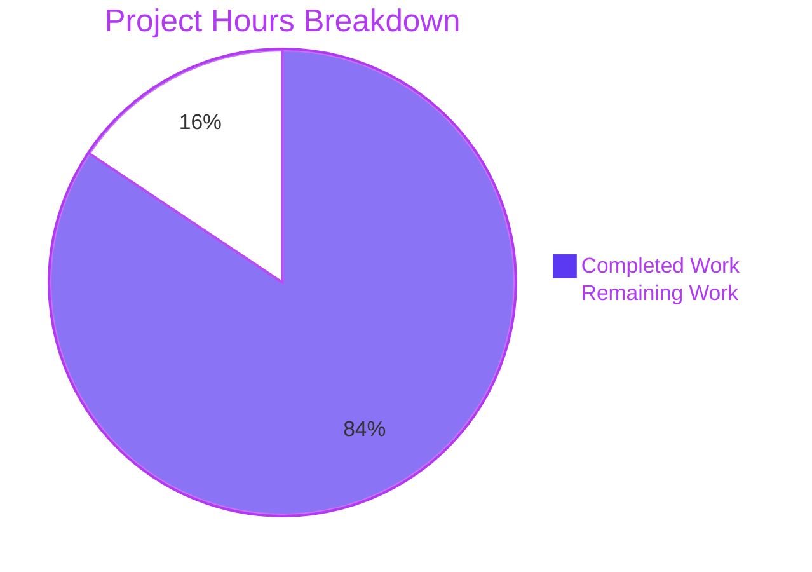
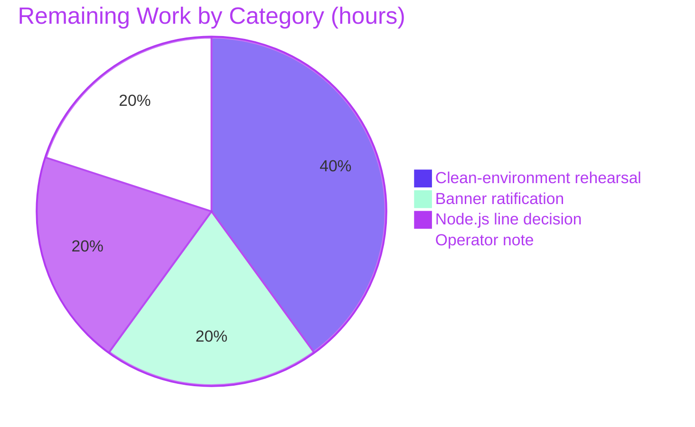

# 1. Executive Summary

## 1.1 Project Overview

This project turns a two-line tutorial script into a small HTTP service. The repository formerly printed `WELCOME TO BLITZY` once and exited; it now runs an Express server that serves two greeting endpoints and stays up to answer requests. Its audience is anyone following the tutorial — a developer who installs it, starts it and reads a response — and an operator who needs a trustworthy start-up signal. The service is deliberately minimal: one entry file, one pinned dependency, no configuration and no data store.

## 1.2 Completion Status

**84% complete — 27 of 32 hours.** Every requirement in scope is delivered and verified; the remaining hours are one ratification decision and three deployment-side confirmations (Section 2.2).



| Metric | Hours |
|---|---|
| Total Hours | 32 |
| Completed Hours (AI + Manual) | 27 |
| Remaining Hours | 5 |
| Completion | 84% |

## 1.3 Key Accomplishments

- Express 5.3.0 adopted as the framework serving the routes, pinned exactly and reproducible from the committed lock.
- `GET /` answers the exact literal `Hello world` (11 bytes); `GET /goodevening` answers `Good evening` (12 bytes) — both 200 as `text/plain; charset=utf-8`.
- One entry file serves both routes through a shared response pattern, so adding the second could not disturb the first.
- The documented start command now starts a long-lived server on port 3000 or `$PORT`.
- The original `WELCOME TO BLITZY` line survives character for character and appears only once the socket is bound.
- The dependency tree stays out of the repository, and the lock keeps the install reproducible and audit-clean; `README.md` documents the install step, the port and both responses with their content type.

## 1.4 Critical Unresolved Issues

**4 open items of the 39 requirements the work was scoped against** — one ratification decision and three deployment-side confirmations. No requirement is unbuilt.

| Issue | Impact | Owner | ETA |
|---|---|---|---|
| The startup banner is registered on the server's `listening` event rather than in the `app.listen` callback the plan's listing shows (`index.js:10`) | None on behaviour: same literal, same single emission on a successful bind; a taken port fails loudly instead of reporting a false start. Needs a reviewer's ratification (Section 5.2) | Code owner / reviewer | Before first release |
| The documented install-and-run story has not been rehearsed in a clean environment against the deployment's own port value | The deployment's runtime and port combination is unproven until that run | Platform / DevOps with code owner | At deployment |
| `engines.node` declares a floor of `>=18` while the runtime exercised end to end is Node 22.23.x | A consumer on an older line runs a combination never verified | Code owner | At deployment |
| No operator note exists for a failed start (a taken or malformed port exits non-zero with no banner) | A supervisor that keys only on the banner could misread the absence of a start signal | Deployment runbook owner | At handover |

## 1.5 Access Issues

No access issues identified. The project needs no credential, API key, service account, database or third-party access: it reads one optional environment variable (`PORT`) and reaches no external resource at runtime.

## 1.6 Recommended Next Steps

1. **[High]** Ratify the banner registration at `index.js:10` — it preserves the plan's stated behaviour, the line appearing only when the socket is bound, while departing from the plan's illustrative listing (Section 5.2).
2. **[High]** Rehearse the two documented steps on the deployment host with its own `PORT` and confirm both endpoints answer there.
3. **[Medium]** Settle the supported Node.js line and record it for operators.
4. **[Medium]** Note in the runbook that a non-zero exit with no banner means the port could not be bound.
5. **[Low]** Keep the external acceptance checks in the release procedure, since the repository carries no automated gate by design.

# 2. Project Hours Breakdown

## 2.1 Completed Work Detail

| Component | Hours | Description |
|---|---|---|
| Dependency adoption, manifest and lock | 6 | Declares the project and pins `express` at exactly `5.3.0`; generates and verifies the lock that pins the 65-package tree; adds the ignore rule that keeps the installed tree out of the repository (`package.json`, `package-lock.json`, `.gitignore`). |
| Express server and endpoint contract | 8 | The framework import, the application object, the port resolution and the two literal routes on one shared response pattern, with plain text set explicitly so both bodies are byte-exact (`index.js:2-8`). |
| Port, listener and start-up banner | 4 | Port 3000 by default with the `PORT` override, the listener that makes the process long-lived, and the retained `WELCOME TO BLITZY` line registered so that it appears only once the socket is bound (`index.js:5`, `index.js:10`). |
| Run story and documentation | 3 | `README.md` line 3's install-and-run instruction and the block below it stating the port, the `PORT` override, the `npm start` equivalence and both endpoints with their exact responses and content type; the two pre-existing lines left unchanged. |
| External acceptance verification | 4 | The documented install, the syntax gate, the start, and the endpoint checks with byte-level body comparison, including the banner's exact bytes and the port override (`README.md:3`, `index.js:7-10`). |
| Whole-package gate and end-to-end re-verification | 2 | The published project gate — install, syntax check and dependency audit — plus the two endpoint checks and the start-up failure path exercised against the integrated revision. |
| **Total** | **27** | |

## 2.2 Remaining Work Detail

| Category | Hours | Priority |
|---|---|---|
| Ratify the startup-banner registration form at `index.js:10` against the plan's stated form and record the decision (Section 5.2) | 1 | High |
| Rehearse the documented install-and-run in a clean environment against the deployment's port value and confirm the committed lock reproduces the pinned tree there | 2 | Medium |
| Decide and record the supported Node.js line (`engines.node` declares `>=18`; the exercised runtime is 22.23.x) | 1 | Medium |
| Capture the operator note that a taken or malformed port exits non-zero with no banner | 1 | Low |
| **Total** | **5** | |

## 2.3 How These Hours Were Derived

Total project hours are 32: 27 completed plus 5 remaining. Completion is `27 / 32 × 100 = 84%`, the figure stated in Section 1.2 and charted in Section 7. Completed hours are estimated from the delivered artefacts and the verification performed against them — the manifest, lock and ignore rule; the ten-line server and its response discipline; the port and readiness behaviour; the documentation block; the external acceptance checks; and the whole-package gate. Remaining hours cover only the single divergence requiring a human decision and the three path-to-production confirmations; no hour is attached to scope the request excluded (a test suite, a linter, hardening, deployment configuration or any endpoint beyond the two). Every component in Section 2.1 traces to a requirement of the plan, and every category in Section 2.2 traces to the divergence in Section 5.2 or to a deployment-side confirmation.

# 3. Test Results

The repository ships no test suite and no test framework: the project's scope excludes adding one, and `npm test` exits non-zero with `Missing script: "test"`. Every check below was therefore executed against the running service from outside the process — the acceptance model this project defines. 48 checks ran, 48 passed, 0 failed. No coverage figure appears in this section, because no coverage tooling exists in the repository and none may be added.

| Area / Category | Framework | Tests | Passed | Failed | Coverage | What This Proves |
|---|---|---|---|---|---|---|
| Install, dependency and syntax gate | Node.js, npm, npm audit (no test framework in the repository) | 4 | 4 | 0 | Not measured — no coverage tooling exists or may be added | The committed lock reinstalls the pinned 65-package tree and that tree carries no known vulnerabilities; the only source file parses cleanly. |
| Endpoint contract | curl with byte-for-byte body comparison | 11 | 11 | 0 | Not measured | Both endpoints answer their exact literals — 11 and 12 bytes — with HTTP 200 and `text/plain; charset=utf-8`. |
| Start-up, readiness and stream discipline | Capture of standard output, standard error and exit status | 11 | 11 | 0 | Not measured | The banner appears exactly once and only when the socket is bound; a taken port exits non-zero with a diagnostic; nothing is written per request. |
| Routing edges | curl | 6 | 6 | 0 | Not measured | Only the two registered paths answer with a greeting; unmatched paths and unregistered methods receive the framework's own 404. |
| Concurrency and stability | 30 parallel curl requests | 2 | 2 | 0 | Not measured | One process serves repeated and simultaneous traffic with every response exact and its output stream unchanged. |
| Browser verification | Headless Chrome (DOM, network and console inspection) | 14 | 14 | 0 | Not measured | Both endpoints reach a real browser as plain text with the documented status, type and length, and no interface, script or console error appears. |
| **Total** | | **48** | **48** | **0** | | |

**Not Covered** — what no test in this project exercises, and what a human should check before release:

- **Any automated regression check.** There is no unit, integration or end-to-end suite, no runner, no linter, no formatter, no type checker and no pipeline, and the project's scope excludes adding any. Nothing fails locally if a response literal, a route path, the banner text or a published value in `README.md` is edited later. Before release, re-run the external acceptance set: install, start, then read both responses and compare them byte for byte.
- **The framework's error-handling path.** Both handlers send constant strings and no error-handling middleware exists, so no route can raise an error and the framework's default error page is unreachable. If a handler ever grows a throwing path, that path is unverified.
- **A user interface.** The service renders none: both responses are plain text and the project contains no markup, style sheet, client bundle or template. There is no screen, interaction or visual state to test, in a browser or otherwise.
- **Conditional-request caching.** The framework emits a weak `ETag` on both responses, but no revalidating request was made, so a `304 Not Modified` path is untested.
- **Framework-internal diagnostics.** With `DEBUG=express:*` set in the environment, the framework writes internals to standard error; that path was not exercised and nothing in the delivered code controls it.
- **Routing spellings beyond the two registered paths.** Case variants and a trailing slash also answer with the greeting because of framework defaults, which the project intentionally leaves in place; these spellings are the framework's behaviour rather than delivered logic and are asserted nowhere.
- **Any external integration.** There is none to exercise: no database, cache, queue, outbound call or third-party service exists in the project.

# 4. Runtime Validation & UI Verification

Every flow below was driven against the running service, on the documented default port and on override ports, with the process's two output streams and exit status captured. Each line states what was exercised and what was seen.

- ✅ **Start-up on the documented default port** — the server bound port 3000; standard output was exactly the 18 bytes `WELCOME TO BLITZY` plus a newline, written once; standard error was empty.
- ✅ **Manifest-driven start** — `npm start` printed npm's own preamble and then the same single banner and served both routes.
- ✅ **`GET /`** — HTTP 200, `Content-Type: text/plain; charset=utf-8`, `Content-Length: 11`, body byte-identical to `Hello world`, confirmed by curl and rendered by a real browser.
- ✅ **`GET /goodevening`** — HTTP 200, same media type, `Content-Length: 12`, body byte-identical to `Good evening`, confirmed the same two ways.
- ✅ **Unmatched paths** — a request for a path the service does not register receives the framework's own 404 page (`Cannot GET /nope`), never a greeting.
- ✅ **Method surface** — `HEAD` on both routes answers 200 with the same headers and an empty body; `POST` to a greeting path receives the framework's 404.
- ✅ **Port override** — with `PORT` set, the service bound that port and served both routes there, leaving the default free.
- ✅ **Port already in use** — a second process on the port exited 1 with 0 bytes on standard output, no banner, and Node's own `Error: listen EADDRINUSE: address already in use` on standard error, while the running instance kept serving.
- ✅ **Repeated and parallel traffic** — 30 concurrent requests all returned the exact 12-byte body, and standard output remained 18 bytes after every request, so nothing is logged per request.
- ✅ **Browser rendering** — both endpoints were fetched by headless Chrome as plain-text documents with 0 scripts, 0 style sheets, 0 images, 0 links and 0 form controls: no user interface is rendered, and no JavaScript error or warning appeared (the only console entry was the browser's automatic favicon probe answering 404).

**Never exercised at runtime.** There is no user interface, so no screen, interaction, navigation or visual state exists to drive. No error-handling path is reachable: both handlers send constant strings and the project deliberately adds no error middleware, so a 5xx response cannot be produced and the framework's default error page was never triggered. Conditional-request caching was not exercised — the weak `ETag` was present on both responses but no revalidating request was made, so the `304` path is untested. The framework's debug channel (`DEBUG=express:*`) was not exercised. No database, cache, queue, scheduled task, outbound HTTP call or third-party service exists in this project, so no integration of that kind could be validated at runtime. Ports 3000, 3400-3402 and 3410-3412 were used during this validation and all were released; no server process was left running.

# 5. Compliance & Quality Review

## 5.1 Compliance Matrix

| # | Deliverable | Verified Status | Progress | Evidence |
|---|---|---|---|---|
| 1 | Express adopted as the framework that serves the routes | ✅ Pass | 100% | `package.json:13`, `index.js:2`, both routes answered by it |
| 2 | `GET /` returns the exact literal `Hello world` (11 bytes) | ✅ Pass | 100% | `index.js:7`; byte comparison against the literal |
| 3 | `GET /goodevening` returns the exact literal `Good evening` (12 bytes) | ✅ Pass | 100% | `index.js:8`; byte comparison against the literal |
| 4 | One shared response pattern with plain text set explicitly | ✅ Pass | 100% | `index.js:7-8`; wire shows `text/plain; charset=utf-8`, `Content-Length` 11 and 12 |
| 5 | The server lives in the file the documented command runs; no second entry point | ✅ Pass | 100% | `README.md:3`, `package.json:5,7`, `index.js` |
| 6 | Port chosen, defaulted to 3000, overridable with `PORT`, documented | ✅ Pass | 100% | `index.js:5`, `README.md:5`; both paths exercised |
| 7 | Retained start-up banner that marks a bound socket | ✅ Pass (one recorded divergence in form) | 100% | `index.js:1`, `index.js:10`; banner on bind only, absent on a failed bind |
| 8 | Manifest with the exact field contract and an exact dependency pin | ✅ Pass | 100% | `package.json:1-15` |
| 9 | Committed lock pinning the dependency tree; reproducible install | ✅ Pass | 100% | `package-lock.json` (lockfileVersion 3, 65 entries); clean reinstall exits 0 |
| 10 | Repository hygiene: dependency tree ignored, lock tracked | ✅ Pass | 100% | `.gitignore:1`; `git check-ignore` confirms the installed tree is ignored |
| 11 | Run story and endpoint documentation, with pre-existing lines unchanged | ✅ Pass | 100% | `README.md:3,5,6,8-11`; lines 1-2 byte-identical to the base revision |
| 12 | Scope discipline: every excluded artefact absent, nothing outside the plan added | ✅ Pass | 100% | Five changed paths only; 0 occurrences of middleware, extra endpoints, tooling or configuration |

## 5.2 AAP & Rule Divergences and Gaps

Two departures were identified. One is substantive and needs a reviewer's ratification; the other is a recorded detail the governing source requires. No divergence from user rules exists, because no user rules were provided for this project.

| # | What the AAP/Rule Required | What Was Delivered Instead | Why It Diverged | Impact | Remediation |
|---|---|---|---|---|---|
| D1 | The plan's listing for `index.js` and its cross-cutting decision register the banner inside the `app.listen` callback: `app.listen(port, () => console.log("WELCOME TO BLITZY"));` (AAP §0.8.2, §0.7 CC-6) | `app.listen(port).on("listening", () => console.log("WELCOME TO BLITZY"));` — the same callback registered on the returned server's `listening` event (`index.js:10`) | On Express 5.3.0, `app.listen` wraps a supplied callback with `once()` and registers it as the server's first `'error'` listener (`node_modules/express/lib/application.js:598-606`), so the listed form prints the readiness banner when the port is already taken. The plan states the line's purpose as "printed when the socket is bound" (§0.1.1 I5, §0.4, §0.5.5, CC-6), which the listed form cannot deliver on this framework version, so the behavioural requirement governs the illustrative listing. No statement, guard, handler or log line was added | None on the documented behaviour: the literal, its count and its channel are unchanged and both endpoints are untouched. A taken port exits 1 with Node's own diagnostic rather than exiting 0 with an empty error stream | Ratify and record the decision (1 hour, Section 2.2). Restoring the listed text verbatim would require pinning an Express release whose `app.listen` does not register the callback as an error listener, which the plan's own pin forbids |
| D2 | The ignore file holds the single rule `node_modules/` as one line (AAP §0.8.1, §0.8.2) | The same rule as stored: 13 content characters plus the file's terminating newline (`.gitignore`) | A line ends with a newline, and a file without the terminator is not a line; the governing requirement is the single rule, which is what the file carries | None: the rule parses and applies, and the dependency tree is ignored in practice | None required |

**The substantive divergence, in detail.** `index.js:10` is the project's single start-up signal, and the plan states its meaning precisely: it appears when the socket is bound, so its appearance means the service is ready. Written as the plan's listing shows it, that meaning cannot hold on Express 5.3.0 — the framework re-registers the callback as the server's first error listener, so a start on a taken port prints the banner, writes nothing to standard error and exits 0, and an operator keying on the line reads a failed start as a good one. The delivered form keeps the identical literal, the single emission and the same output channel, adds no guard, handler or log line, and makes the failure path honest: exit 1, no banner, Node's own `EADDRINUSE` diagnostic on standard error. A reviewer should ratify this line, or require the listing's text and a different Express release.

**For readers comparing the previously delivered record with the code.** That record states five constraints this plan deliberately superseded in the request's favour, each only as far as the request reaches: the entry file was fixed at two lines and 88 bytes with no dependencies; the README's run line was fixed verbatim with no further instruction permitted; no HTTP endpoint, socket or bound port existed; both delivered files were frozen by the previous specification; and no environment variable was read. The record itself is kept byte-identical and is not a working document — `README.md` is the current source of truth for how to run the service.

# 6. Risk Assessment

These are forward-looking risks only — what could still go wrong once this service is run or changed.

| Risk | Category | Severity | Probability | Mitigation | Status |
|---|---|---|---|---|---|
| Nothing automated guards the delivered values: no test suite, runner, linter, formatter, type checker or pipeline exists or may be added, so a later edit to a response literal, a route path, the banner text or a published value in `README.md` fails no local check | Technical | Medium | Medium | Keep the external acceptance set in the release procedure: install, start, read both responses and compare them byte for byte | Open — accepted by design |
| The exact dependency pin is only as durable as the install command: this host's npm default writes a caret range, so a plain `npm install express@<version>` would rewrite both the manifest spec and the lock's root entry | Technical | Low | Medium | Always install with `--save-exact`, and inspect `package.json` and `package-lock.json` after any install or dependency change | Open |
| The declared runtime floor (`engines.node` `>=18`) is broader than the runtime exercised end to end (Node 22.23.x), so a consumer on an older line runs a combination never verified | Technical | Medium | Low | Settle the supported Node.js line for this deployment and record it for operators (Section 2.2) | Open |
| No health, readiness or metrics surface exists, and the only start-up signal is the printed banner, so machine supervision must key on the process itself | Operational | Medium | Medium | Supervise on process liveness and exit status: a start that cannot bind exits non-zero with no banner instead of reporting success | Open — sanctioned |
| `PORT` is read without validation: a non-numeric value makes the runtime bind a Unix socket named after the value in the working directory while the banner still appears, and an out-of-range value fails at listen | Operational | Low | Low | Supply a numeric port value, and treat a banner that is not followed by an answering port as a configuration fault | Open — sanctioned |
| Nothing is logged per request, so unusual or abusive traffic leaves no application-level trace | Operational | Low | Medium | Terminate and log at a reverse proxy if request visibility is required | Open — sanctioned |
| The service is unauthenticated, binds every interface with no TLS, applies no rate limiting and advertises the framework via `X-Powered-By` | Security | Low | Low | Acceptable for two constant public strings; front the service with a reverse proxy that provides TLS and access control before exposing it more widely | Open — sanctioned |
| The framework's own 404 page echoes the requested path into its HTML body | Security | Low | Low | Inert as delivered — the path is normalised and escaped, and the error response carries the framework's `default-src 'none'` and `nosniff`; re-assess only if the surface grows | Open — monitor |

No integration risk remains: the project has no database, cache, queue, scheduled task, outbound call or third-party service, and its single dependency is pinned by the committed lock and free of known vulnerabilities. The one integration-shaped concern is environmental rather than in the code — the deployment's runtime and port combination should be exercised once on the target host (Section 2.2).

# 7. Visual Project Status

**Delivery against scope: 27 of 32 hours complete — 84%.** Completed work is shown in dark blue; remaining work in white.


| Status | Hours | Share |
|---|---|---|
| Completed Work | 27 | 84% |
| Remaining Work | 5 | 16% |
| **Total** | **32** | **100%** |

**Remaining work by category** — the same 5 hours as Section 2.2, split by the kind of work left:

| Category | Hours | Priority |
|---|---|---|
| Ratification of the banner registration form (`index.js:10`) | 1 | High |
| Clean-environment rehearsal of the documented install-and-run on the deployment's port | 2 | Medium |
| Supported Node.js line: decide and record | 1 | Medium |
| Operator note for a failed start | 1 | Low |



All delivery milestones are closed: the manifest, lock and ignore rule are in place; the server serves both literals; the retained banner marks a bound socket and nothing else; the documentation describes what exists; and every excluded artefact is absent by decision. The only work left is the single ratification and the three deployment-side confirmations above.

# 8. Summary & Recommendations

The repository now runs an Express server where it previously printed one line and exited. `index.js` loads Express 5.3.0, resolves the port from the environment with 3000 as the default, serves `GET /` with the exact literal `Hello world` and `GET /goodevening` with the exact literal `Good evening`, both as `200 text/plain; charset=utf-8` at 11 and 12 bytes, and keeps the project's original `WELCOME TO BLITZY` line as its single start-up message. The dependency is pinned exactly in `package.json`, the committed `package-lock.json` reproduces the 65-package tree, `.gitignore` keeps that tree out of the repository, and `README.md` describes how to install and run what now exists.

Those capabilities were exercised rather than assumed. Forty-eight checks passed: a clean reinstall from the lock with no known vulnerabilities, the syntax gate, both endpoints read byte for byte with curl and rendered in a real browser, the start-up banner's exact 18 bytes, the override port, an unmatched path and an unregistered method, thirty parallel requests with the process's output stream unchanged, and the failure path — a second start on a taken port exits non-zero with a diagnostic and no banner, so the start-up signal is truthful in both directions. Section 3 lists what remains unexercised: no automated suite exists to run, no error-handling path is reachable, no interface is rendered, and conditional-request caching was not triggered.

Delivery is **84% complete** on an hours basis: 27 hours completed of 32, with 5 hours left. No requirement in scope is unbuilt. What remains is one ratification — the start-up banner is registered on the server's `listening` event instead of inside the `app.listen` callback the plan's listing shows, a change that preserves the line's stated meaning on Express 5.3.0 and makes a failed bind fail loudly (Section 5.2) — plus three deployment-side items: rehearse the documented install-and-run on the deployment host with its own port value, settle the supported Node.js line, and record the operator note that a non-zero exit with no banner means the port could not be bound.

The critical path to production is short and entirely operational: install, start, confirm both responses on the target host, and confirm the deployment's port value. The service is production-ready for what it was scoped to be — a public, unauthenticated tutorial server serving two constant greetings, with a reproducible dependency tree and a start-up signal that can be trusted. It is not hardened, and by decision it will not be: no authentication, TLS, rate limiting, request logging, health endpoint or additional hardening exists, which is correct for two fixed strings that read no input, and would need revisiting before the service carried anything else.

| Metric | Value |
|---|---|
| Scope completion (hours) | 84% — 27 of 32 hours |
| Requirements delivered | 39 of 39; 4 carry an open follow-up item |
| Checks executed | 48 passed, 0 failed; no coverage measured (no tooling, by decision) |
| Endpoints exercised | 2 of 2, byte-exact, via curl and a real browser |
| Runtime flows validated | 10 of 10 attempted |
| Known vulnerabilities in the dependency tree | 0 |
| Open divergences | 1, needing a reviewer's ratification |

# 9. Development Guide

Every command below was executed from the repository root against the delivered code, and the observed output is quoted. There is nothing to build: the runtime executes the source directly, and `node --check` is the project's only static gate.

### System Prerequisites

- **Node.js and npm.** `package.json` declares `engines.node` `>=18` (the framework's own floor). The combination exercised end to end here is Node 22.23.4 with npm 11.21.0. Verify with:
  ```bash
  node --version   # v22.23.4
  npm --version    # 11.21.0
  ```
- **No other service is required.** No database, cache, message broker, container runtime or external API is used, and there is no environment file or credential to configure.
- **Network access to the public npm registry** is needed once, for the install step only.

### Environment Setup and Dependency Installation

The project has no environment file: the only environment input is the optional `PORT`, set at start-up. Install the dependency tree from the committed lock — this is the step that makes the project runnable, since the dependency directory is deliberately not tracked:

```bash
npm install        # honours the exact pin in package.json
# or, for a byte-for-byte reproduction of the committed lock:
CI=true npm ci
```

Observed: `CI=true npm ci` exits 0 with `added 65 packages, and audited 66 packages in 410ms` and `found 0 vulnerabilities`; the installed framework reports 5.3.0. Confirm the tree if you wish:

```bash
node -e 'console.log(require("./node_modules/express/package.json").version)'   # 5.3.0
```

### Static Gate

```bash
node --check index.js    # exit 0, no output
```

### Application Startup

Start the service from the repository root. It prints one line and then stays in the foreground, so run it in its own terminal or background it:

```bash
node index.js
# or the equivalent npm script:
npm start
```

Observed: standard output is exactly `WELCOME TO BLITZY` (18 bytes with the newline), written once when the socket is bound; standard error stays empty. The service listens on **port 3000**, or on the port named by the `PORT` environment variable when that is set — useful when several services share a host:

```bash
PORT=8080 node index.js
```

### Verification Steps

With the service running, read each response from a second shell:

```bash
curl -s http://localhost:3000/                 # Hello world
curl -s http://localhost:3000/goodevening      # Good evening
curl -s -o /dev/null -w '%{http_code}\n' http://localhost:3000/            # 200
curl -s -o /dev/null -w '%{http_code}\n' http://localhost:3000/goodevening # 200
curl -s -i http://localhost:3000/goodevening   # 200 OK, Content-Type: text/plain; charset=utf-8, Content-Length: 12
curl -s http://localhost:3000/ | wc -c         # 11
curl -s http://localhost:3000/goodevening | wc -c   # 12
curl -s -I http://localhost:3000/              # 200 with the same headers and no body
```

Expected: both bodies exactly as shown, with no trailing newline, no punctuation and no markup; a request for any other path receives the framework's own 404 page. The banner's meaning can be relied on: it appears only when the socket is bound, and standard output does not grow as requests are served.

### Example Usage

```bash
# Terminal 1 — start the service on an explicit port
$ PORT=8080 node index.js
WELCOME TO BLITZY

# Terminal 2 — read both greetings
$ curl -s http://localhost:8080/ ; echo
Hello world
$ curl -s http://localhost:8080/goodevening ; echo
Good evening

# Terminal 3 — a path the service does not register returns the framework's 404
$ curl -s -o /dev/null -w '%{http_code}\n' http://localhost:8080/hello
404
```

### Troubleshooting

| Symptom | Cause | Resolution |
|---|---|---|
| `Error: Cannot find module 'express'`, exit 1 | The dependency tree is not installed in this checkout (`node_modules/` is intentionally untracked) | Run the install step above first; the committed lock reproduces the verified tree |
| `Error: listen EADDRINUSE: address already in use :::3000`, exit 1, no banner | Another process already holds the port | Stop that process, or start with a different port (`PORT=8080 node index.js`) |
| The process starts, prints the banner, but nothing answers on the port you expected | `PORT` was set to a non-numeric value: the runtime binds a Unix socket named after that value in the working directory instead of a TCP port, and the line still prints | Supply a numeric port; if the process ran from the repository root, remove the leftover socket file whose name is the value you set |
| `RangeError [ERR_SOCKET_BAD_PORT]` at start-up | `PORT` is outside the valid range (0-65535) | Supply a port inside that range |
| `npm error Missing script: "test"`, exit 1 | The project deliberately has no test suite and no test script; adding one is outside its scope | Do not add a test script. Verify behaviour with the curl checks above — that is the project's acceptance model |
| A request to a near-variant path such as `/goodevening/` or `/GOODEVENING` answers with the greeting | The framework's default path matching is case-insensitive and tolerant of a trailing slash | Expected; only the two registered paths are documented |

Additional notes for operators: a failed start exits non-zero with Node's own diagnostic and prints no banner, so a supervisor can treat a non-zero exit as a failed start; and the framework emits `X-Powered-By: Express` plus a weak `ETag` on both responses, both left in place by decision.

# 10. Appendices

## Appendix A — Command Reference

| Command | Purpose | Observed result |
|---|---|---|
| `npm install` | Install the pinned dependency tree from `package.json` and the committed lock | exit 0; tree matched, 0 vulnerabilities |
| `CI=true npm ci` | Reproduce the dependency tree byte for byte from `package-lock.json` | exit 0; added 65 packages, audited 66, 0 vulnerabilities |
| `node --check index.js` | Syntax gate — the project's only static check | exit 0, no output |
| `node index.js` | Start the service in the foreground | prints `WELCOME TO BLITZY` once the socket is bound |
| `npm start` | Equivalent to `node index.js` | npm's preamble, then the same single banner |
| `PORT=<n> node index.js` | Start on an explicit port | binds `<n>` and serves both routes there |
| `npm audit --omit=dev` | Check the production dependency tree for known vulnerabilities | exit 0, `found 0 vulnerabilities` |
| `npm test` | — | exit 1, `Missing script: "test"`: no suite exists by design |
| `curl -s http://localhost:<port>/` | Read the first greeting | `Hello world`, 11 bytes, 200 |
| `curl -s http://localhost:<port>/goodevening` | Read the second greeting | `Good evening`, 12 bytes, 200 |
| `curl -s -i http://localhost:<port>/goodevening` | Inspect status, headers and body together | `HTTP/1.1 200 OK`, `Content-Type: text/plain; charset=utf-8`, `Content-Length: 12` |
| `curl -s -I http://localhost:<port>/` | Exercise a HEAD request | 200, same headers, empty body |
| `curl -s http://localhost:<port>/<other>` | Confirm the framework's 404 | 404 with `Cannot GET /<other>` |

## Appendix B — Port Reference

| Port | Use |
|---|---|
| 3000 | Default listening port, published in `README.md:5` and used by the documented examples |
| `$PORT` | Optional override; when set and numeric, the service binds it instead of 3000 |
| any other port | Used only for local validation runs; nothing in the code depends on it |

The listener binds the host's default address (no host argument is passed), so the service is reachable on every interface of the host. There is no second port, no metrics port and no management port.

## Appendix C — Key File Locations

| Path | Role |
|---|---|
| `index.js` | The whole service: framework import, application, port resolution, both routes and the listener (10 lines) |
| `package.json` | Project identity, entry point, start script, runtime floor and the exact dependency pin |
| `package-lock.json` | Pins express 5.3.0 and its 65-package transitive tree with resolved URLs and integrity hashes |
| `.gitignore` | One rule, `node_modules/`, keeping the installed tree out of the repository |
| `README.md` | The run story: install step, port, `npm start` equivalence and both endpoints with their responses and content type |
| `blitzy/documentation/Project Guide - 8afb1828-c161-4751-8c48-bca9c0219f00.md` | The record of the project's previous delivery, kept exactly as delivered; it describes the state before this work |

## Appendix D — Technology Versions

| Component | Version | Note |
|---|---|---|
| Node.js | 22.23.4 (exercised); `engines.node` declares `>=18` | The declared floor is the framework's own minimum; only the 22.x runtime was exercised |
| npm | 11.21.0 | This host's npm writes a caret range by default, so always install with `--save-exact` when touching the pin |
| Express | 5.3.0, pinned exactly in `package.json` and `package-lock.json` | Current supported line; the release that carries the `body-parser` bump for CVE-2026-12590 |
| Module system | CommonJS | `require("express")` in the code; no `type` field in the manifest |
| Lock file format | lockfileVersion 3 | 65 pinned entries plus the root entry |

## Appendix E — Environment Variable Reference

| Variable | Required | Default | Effect |
|---|---|---|---|
| `PORT` | No | `3000` | The TCP port the service binds. It is the only environment variable the delivered code reads, and a numeric value is required — a non-numeric value is treated by the runtime as a socket path rather than a port |

No `.env` file, secret, credential or configuration file is read or provided. `DEBUG=express:*` in the environment makes the framework write its own internals to standard error; the delivered code neither sets nor depends on it.

## Appendix F — Developer Tools Guide

| Tool | Used for | Command |
|---|---|---|
| Node.js runtime | Running the service and the syntax gate | `node index.js`, `node --check index.js` |
| npm | Installing from the lock, running the start script, auditing the dependency tree | `npm install`, `npm ci`, `npm start`, `npm audit --omit=dev` |
| curl | Reading and asserting both responses, headers, statuses and byte counts | see Appendix A |
| A browser | Confirming both endpoints arrive as plain text with no interface and no console errors | open `http://localhost:3000/` and `/goodevening` |

There is no linter, formatter, type checker, bundler, test runner or coverage tool in this project, and none is in scope: `node --check` plus the curl checks are the whole toolchain.

## Appendix G — Glossary

| Term | Meaning |
|---|---|
| AAP | The Agent Action Plan — the technical specification this delivery was measured against |
| Entry point | `index.js`, the single file the documented command runs; it is the whole service |
| Readiness signal | The `WELCOME TO BLITZY` line, printed once when the socket is bound, so its appearance means the service is answering |
| Shared response pattern | `res.type("text/plain").send(<literal>)`, used identically by both routes so they cannot drift apart |
| Framework defaults | Behaviour Express provides without configuration and that this project intentionally leaves in place: `X-Powered-By`, weak `ETag`, case-insensitive and trailing-slash-tolerant path matching, and the default 404 page |
| Pin | An exact dependency version (`"5.3.0"`) rather than a range, so the manifest and the lock state one version between them |
| Path-to-production items | The work needed to run the delivered capability in its deployment environment: install, start, and confirm behaviour there |
