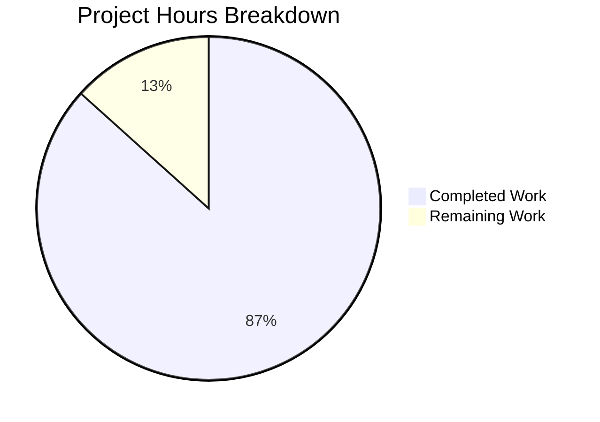

# 1. Executive Summary

## 1.1 Project Overview

A single-statement Node.js console program that prints `Welcome to Blitzy` to standard output with no formatting, plus the repository's run instruction for it. Two files at the repository root carry the deliverable: `index.js`, holding one JSDoc summary and one `console.log` statement, and a one-line addition to `README.md`. There is no framework, database, service, dependency, build step or configuration surface, and the program holds no state and reads no input. The change totals 5 lines and 160 bytes, verified on Node.js v22.23.3.

## 1.2 Completion Status

**13.0 of 15.0 hours complete — 86.7%.**



Completed = Dark Blue (#5B39F3); Remaining = White (#FFFFFF).

| Metric | Hours |
|---|---|
| Total Hours | 15.0 |
| Completed Hours (AI + Manual) | 13.0 |
| Remaining Hours | 2.0 |

## 1.3 Key Accomplishments

- [x] Exact output: `node index.js` prints `Welcome to Blitzy` plus one newline — 18 bytes, exit status 0, nothing on standard error.
- [x] Byte-exact source: the two specified lines, 88 bytes, one statement, one tag-free JSDoc summary.
- [x] Run instruction delivered: one appended line, `README.md` still three lines, its earlier content byte-identical (`README.md:3`).
- [x] Deterministic: identical output across sequential and concurrent runs and every input variation.
- [x] Fidelity: the same bytes through pipes, files and a terminal, under empty and locale-varied environments.
- [x] Zero dependencies: no manifest, lockfile or install step; only the runtime's built-in `console`.
- [x] Isolation: unchanged in an empty network namespace and under a sandbox denying filesystem, subprocess and worker access, leaving nothing behind.
- [x] Safe: hostile payloads are never interpreted and injected secrets never reach either stream.

## 1.4 Critical Unresolved Issues

**4 of 24 scoped items remain open** — 19 project requirements plus 5 path-to-production items; 21 fully delivered, one partly delivered, two outstanding, and one caveat to accept.

| Issue | Impact | Owner | ETA |
|---|---|---|---|
| Human acceptance sign-off of the exact content and output, applied by hand because no automated gate may exist | Release cannot be signed off without it | Release owner | Before release — 1.0 h |
| Output and content confirmed on Node.js v22.23.3 only; no runtime is pinned | Behaviour unverified on other runtimes in use | Platform engineer | Before deployment — 0.5 h |
| The runtime prerequisite (a Node.js runtime on `PATH`; invoke from the repository root) has no home in the delivered files | Readers who deviate from the documented command hit a runtime error | Release owner | With release notes — 0.5 h |
| Accepted caveat: no error path exists, so a closed or broken standard output still exits 0 with empty standard error | A consumer cannot detect truncation from the exit status | Consumer team | Accepted — no remediation owed |

## 1.5 Access Issues

No access issues identified. No credential, service, port, database or third-party API is needed, no environment variable is read, and the only prerequisite is a Node.js runtime on `PATH`.

## 1.6 Recommended Next Steps

1. [High] Sign off the content and output by hand: compare both files against the specified content and run `node index.js | od -An -c`, expecting `W e l c o m e t o B l i t z y \n` (1.0 h).
2. [Medium] Run the same check on every Node.js version you deploy; only v22.23.3 has been exercised (0.5 h).
3. [Low] Publish the run prerequisite — runtime on `PATH`, invoked from the repository root — outside the delivered files (0.5 h).
4. [Low] Record `edf634f042214722c7379dc3da493820` as the expected output fingerprint; no hours beyond step 1.

# 2. Project Hours Breakdown

## 2.1 Completed Work Detail

| Component | Hours | Description |
|---|---|---|
| Console program `index.js` — output, structure, literal content | 2.0 | The two-line program that prints the literal greeting, implemented against the fixed content and confirmed to parse cleanly: one JSDoc summary, one top-level semicolon-terminated statement, double-quoted literal, single end-of-file newline. |
| Run instruction in `README.md` | 1.0 | The single appended line stating how to run the program, added as an append that leaves the file's earlier content byte-identical and keeps it at three lines. |
| Output-contract verification | 3.0 | Byte-exactness of the emitted output, stream, terminal, locale and environment fidelity, and determinism across sequential, concurrent and varied invocations. |
| Run-contract and invocation-surface verification | 2.0 | The documented command executed verbatim from the repository root, plus invocation by absolute path, relative path, symlink and from outside the repository, and the repository's two-command acceptance gate. |
| Zero-dependency and no-hardening verification | 2.0 | Confirmation that no package, lockfile, module directory, install or build step exists or is needed, that no handler, environment configuration, logging, monitoring or telemetry was introduced, and that no input is read. |
| Content-integrity, comment and scope verification | 1.5 | Fewest-lines and token discipline, JSDoc shape with no tags, the documentation line ceiling, minimal diff with preserved existing content, and the two-file boundary with no side effect. |
| Hostile-input and secret-handling checks | 1.0 | Adversarial payloads in arguments, standard input and the environment, plus negative probes for credential, token and key leakage into either stream. |
| Acceptance and delivery-integrity confirmation | 0.5 | The exact-content and exact-output acceptance criterion confirmed on the environment's runtime, with working-tree content identical to the committed content. |
| **Total** | **13.0** | |

## 2.2 Remaining Work Detail

| Category | Hours | Priority |
|---|---|---|
| Human acceptance sign-off of the delivered content and exact output, applied by hand because the deliverable may not carry an automated gate | 1.0 | High |
| Confirm content and output on each Node.js version actually deployed — correctness is verified on v22.23.3 and no runtime is pinned | 0.5 | Medium |
| Publish the runtime prerequisite (runtime on `PATH`; invoke from the repository root; expected output) outside the delivered files, whose content is fixed | 0.5 | Low |
| **Total** | **2.0** | |

# 3. Test Results

Ninety-three checks were executed against the delivered tree, which holds `index.js` (2 lines, 88 bytes) and `README.md` (3 lines, 72 bytes): 93 passed, 0 failed.

| Area / Category | Framework | Tests | Passed | Failed | Coverage | What This Proves |
|---|---|---|---|---|---|---|
| Source content contract (`index.js`) | Node.js parse gate plus byte comparison | 16 | 16 | 0 | Not measured — no coverage tooling exists or is permitted; acceptance is byte-exact content | The file ships exactly the two declared lines, one statement, a tag-free one-line JSDoc summary and a single end-of-file newline |
| Runtime output contract | Node.js process checks | 11 | 11 | 0 | Not measured | The program writes exactly the 17-character string plus one newline, exits 0 and writes nothing to standard error |
| Determinism and statelessness | Shell comparison harness | 9 | 9 | 0 | Not measured | Output cannot vary with arguments, standard input, working directory, timezone or repeated execution |
| Documented run contract | Shell harness executing the published line | 8 | 8 | 0 | Not measured | The command the documentation states works as written, by absolute, relative and symlinked path, and on a copy taken outside the repository |
| Terminal, locale and environment fidelity | Shell harness with captured bytes | 11 | 11 | 0 | Not measured | No emitted byte depends on terminal capability, colour flags, locale or environment, and a pseudo-terminal adds only its own carriage return |
| Invocation and argument tolerance | Shell harness | 11 | 11 | 0 | Not measured | Unknown flags and empty, oversized and metacharacter-carrying arguments leave the documented behaviour unchanged |
| Hostile input and secret handling | Shell harness with adversarial payloads | 9 | 9 | 0 | Not measured | No payload is interpreted or echoed, and injected credential, token and key values appear in neither stream |
| Concurrency, stream handling and isolation | Shell harness, 120 concurrent runs | 18 | 18 | 0 | Not measured | Concurrent runs interleave nothing, every stream shape behaves identically, and no file, port, process, log or network artefact is produced |

**Not Covered.** Every capability this project delivers is exercised by the checks above. Two things no in-repository test can cover, because the deliverable may not carry a test suite, manifest or lockfile, are: (1) human acceptance of the exact output against the requirement — run `node --check index.js`, then compare `node index.js | od -An -c` against `W e l c o m e t o B l i t z y \n` through a pipe or file, never through a captured terminal, which renders the newline as CRLF; and (2) behaviour on Node.js runtimes other than v22.23.3, the only one exercised. No coverage percentage is reported: no coverage tooling exists or is permitted, and acceptance rests on byte-exact content and output rather than a coverage target.

# 4. Runtime Validation & UI Verification

Every line below reports a surface that was actually driven on the delivered tree, with what was observed.

- ✅ **Startup and run** — `node index.js` from the repository root: exit status 0, 18 bytes on standard output, 0 bytes on standard error, process self-terminating.
- ✅ **Output bytes** — exactly the 17-character string plus one newline: no escape sequence, colour code, emoji, banner, wrapper, `Output:` label or surrounding quotation mark, and a single line.
- ✅ **Determinism** — one distinct output and one distinct digest across 20 and 100 sequential runs, 20/40/100-way concurrency, and every argument, standard-input, working-directory, timezone and module-load variation.
- ✅ **Documented command** — the line published in `README.md:3` extracted and executed verbatim from the repository root produced byte-identical output, and the repository's two-command gate printed its success marker.
- ✅ **Stream handling** — redirect to a file, to `/dev/null`, to `/dev/full`, through a pipe, with a closed descriptor and with an early-closing reader: exit status 0 in every shape, no diagnostic output (see the accepted caveat in Section 6).
- ✅ **Terminal, locale and environment fidelity** — pipe, file and terminal captures agree, and output is byte-identical under colour flags, an empty environment, hostile `HOME`/`TMPDIR`/`TZ` values and every locale configuration available on the host.
- ✅ **Argument and standard-input tolerance** — unknown flags, 500 and 3 000 arguments, a 100 000-character argument, non-ASCII and newline-carrying arguments, and empty, closed, 1 MB and 8 MB standard input: documented behaviour unchanged.
- ✅ **Isolation and non-invasiveness** — unchanged inside an empty network namespace and under a sandbox denying filesystem, subprocess and worker access; no file created or modified in the repository, no listening port, no lingering process, no log or cache artefact.
- ✅ **Hostile input** — script, command-substitution, shell-metacharacter and SQL payloads delivered as arguments, input and environment are never interpreted, and injected credential, token and key values appear in neither stream.
- ➖ **Never exercised, because it does not exist** — there is no HTTP endpoint, API, database, queue, scheduler, authentication flow, third-party integration or deployment pipeline, and the program renders no user interface, so there is no screen to open and no browser or visual check that applies to this deliverable. Nothing of this kind was simulated or assumed.

# 5. Compliance & Quality Review

## 5.1 Compliance Matrix

| Deliverable / Benchmark | Verified State | Evidence |
|---|---|---|
| Exact, unformatted output | ✅ Pass | `index.js:2`; 18-byte output verified through pipes, files and a terminal |
| Minimal implementation and token discipline | ✅ Pass | 2 lines / 88 bytes; one statement, one comment line, no wrapper, helper or second statement |
| Comment discipline: one-line JSDoc, no tags | ✅ Pass | `index.js:1`; zero `@param`, `@returns` or `@example` occurrences |
| Documentation: run instruction, under five lines, no forbidden section | ✅ Pass | `README.md` is 3 lines; the documented command works as written |
| Determinism and no external input | ✅ Pass | No argument, environment, file or clock dependency; one distinct output across every variation |
| Accurate install and run story | ✅ Pass | Nothing installed or built; no manifest, lockfile or dependency directory exists |
| Zero dependencies | ✅ Pass | Zero `require`/`import` occurrences; the tracked tree is exactly two files |
| No unrequested hardening | ✅ Pass | No handler, environment configuration, logging, monitoring or telemetry in either file |
| Minimal diff with existing content preserved | ✅ Pass | 3 insertions / 0 deletions; the pre-existing documentation lines are byte-identical |
| Performance expectations | ✅ Pass (no budget) | One synchronous write at process start; nothing measured and nothing claimed |
| Repository hygiene and the two-file boundary | ✅ Pass | Exactly two tracked files, no tracked directory, clean working tree, no side effect from any run |
| Security baseline | ✅ Pass | No credential, token or endpoint in either file; no input accepted; hostile payloads not interpreted; injected secrets never echoed |

## 5.2 AAP & Rule Divergences and Gaps

| What the AAP / Rule Required | What Was Delivered Instead | Why It Diverged | Impact | Remediation |
|---|---|---|---|---|
| Standard quality benchmark: a test suite or test files with a coverage gate | No test file, test suite, lockfile or manifest anywhere in the tree; byte-exact content and output are the acceptance criterion | The user's binding directives forbid adding a test suite, test files, a lockfile or any dependency, and the zero-dependency requirement repeats it; the specification substitutes the exact file contents as the criterion | No automated regression guard: a future edit to the literal, the comment or the run line is caught only by re-reading | None owed — the manual acceptance step in Section 2.2 covers this; adding a suite would breach the delivered scope |
| Standard commit procedure: run a linter on each modified file | No linter or formatter was run or added; no lint configuration or binary exists | The repository ships no linter, formatter or configuration, and the zero-dependency directive forbids adding tooling, so there was nothing to run | None — style is already fixed by the specified content | None owed; anyone wanting a lint pass can run one on a throwaway copy |
| AAP §0.8.1: branded `# Welcome to Blitzy` title, reserved for a repository with no `README.md` | The pre-existing slug `# bip-np-2-testing-4c516918` is retained as line 1 | The file already existed, so the conditional form does not apply; the specification forbids introducing or rewording a title, and the minimal-diff rule requires the earlier lines to stay byte-identical | The documentation never names the program's output string | Human decision only — and it would change the specified deliverable content (`README.md:1`) |
| AAP §0.8.1: the run line's text is fixed verbatim, and no install or further instruction line is permitted | The line states neither the working directory nor the expected output, and no runtime pointer accompanies it | The added line's exact text and the prohibition on further lines are both binding, so nothing could be appended or reworded | A reader must already know that Node.js is on `PATH` and that the command runs from the repository root; the same command by path works from any directory | Publish the prerequisite outside the delivered files (Section 2.2, `README.md:3`) |
| AAP §0.5.1: the file is exactly two lines with no shebang | No shebang and no execute bit, so `./index.js` is refused | The content is fixed as exactly two lines, and the documented invocation is `node index.js` | Direct execution prints `Permission denied` (exit status 126) instead of the greeting | None owed — the documented invocation works by absolute path, relative path and symlink; a shebang would breach the fixed content |
| AAP NFR-3 / §0.7.2: no error handler, signal handler or other hardening | A closed, broken or unwritable standard output still exits 0 with empty standard error | The directives forbid any error or signal handling that was not requested | A consumer reading the output through a pipeline cannot detect truncation from the exit status | None owed — accept the caveat recorded in Section 1.4 and treat a missing line as failure |

**No test suite, test file, lockfile or manifest.** The user's binding directives forbid adding any of them, so the change is accepted on the strength of its content rather than a coverage metric: both files hold exactly the specified bytes, and the output was verified byte-for-byte instead. What a maintainer inherits is that nothing in the repository fails loudly if the greeting, the comment or the run line is edited later; the guard is the comparison in the development guide, and its hours sit in the manual acceptance row of Section 2.2. Adding a suite would breach the delivered scope, so no action is owed.

**No linter or formatter pass.** The standard commit procedure expects a lint pass over each modified file, and none was performed. The reason is verifiable: the repository has no linter, formatter, lint configuration or manifest — `package.json`, `node_modules` and every common formatter and linter configuration are absent — and the zero-dependency directive forbids adding tooling, so there was nothing to run. The impact is nil: the two lines follow the ordinary style the specification fixes, and the documentation carries no markup beyond one pre-existing heading and one code span. No remediation is owed.

**The documentation title keeps the existing repository slug.** The specification provides a branded two-line form — a `# Welcome to Blitzy` heading with the run line — but reserves it for a repository with no `README.md`. The file already existed with two lines, so that form does not apply, and both the instruction to introduce no title and the minimal-diff rule keep the earlier lines byte-identical. The consequence is worth stating, because it is where a reader may expect different wording: nothing delivered names the string the program prints. Closing the gap is a human judgement, and it would change content the specification fixes (`README.md:1`).

**The run line is silent on the working directory and the output.** Its text is fixed verbatim, and no second instruction line, heading or install section may be added. The file therefore neither states that the command assumes the repository root nor says what the program prints, and it carries no pointer that a Node.js runtime must be on `PATH`. A reader who supplies a path to the file succeeds from any directory, as verified; a reader who types the bare relative command elsewhere gets Node's module-resolution error instead of guidance. The gap closes outside the delivered files (Section 2.2).

**The program is not directly executable.** Running `./index.js` without naming the runtime fails with `Permission denied` and exit status 126, because the file has no shebang and no execute bit. That is the specified content, not an oversight: two lines only, invoked as `node index.js`. Readers who follow the documentation are unaffected, and the entry point behaves identically by absolute path, relative path, through a symlink, or as a copy taken outside the repository. A shebang or an execute bit would depart from the fixed content, so no remediation is owed; the caveat is recorded so the refusal is understood.

**A failed write is silent.** With standard output closed, pointed at an unwritable device, or connected to a reader that exits immediately, the program still exits 0 and writes nothing to standard error. The no-hardening directive forbids an error or signal handler, so this is by design and was verified deliberately in those shapes. The consequence falls on consumers: a downstream process cannot infer truncation from the exit status, so a pipeline that must be certain of its input should treat a missing line as failure — the caveat recorded in Section 1.4, needing no work beyond that acknowledgement.

# 6. Risk Assessment

| Risk | Category | Severity | Probability | Mitigation | Status |
|---|---|---|---|---|---|
| No automated gate guards the output string: a later edit to the greeting, the comment or the run line would not fail any check | Technical | Medium | Medium | Apply the byte comparison in the development guide's verification step before each release, and record the expected digest | Open — accepted by design; the deliverable may not carry a test suite or manifest |
| The runtime is unpinned, so correctness has been established on Node.js v22.23.3 only | Technical | Low | Low | Run the same two-command check on each Node.js version actually deployed | Open — 0.5 h in Section 2.2 |
| A failed write is silent: a closed, broken or unwritable standard output still exits 0 and writes nothing to standard error | Operational | Low | Low | Consumers treat a missing output line as failure rather than inferring success from the exit status | Accepted caveat — no remediation owed |
| There is no packaging, publication or deployment path: nothing is built, bundled or served, so there is no artefact to ship | Operational | Low | Low | None required within scope; the documented run command is self-contained | Accepted by scope — no deployment target exists in this project |
| Consumer mis-invocation: direct execution of the file is refused, and the bare relative command fails outside the repository root | Operational | Low | Medium | Publish the runtime prerequisite and the expected output outside the delivered files | Open — 0.5 h in Section 2.2 |
| No integration surface exists: no HTTP endpoint, database, queue, scheduler or third-party service, and no outbound network call | Integration | None | None | Not applicable — the program was verified unchanged inside an empty network namespace, so there is nothing to integrate, authenticate or retry | No risk carried |
| No security surface exists: no credential or secret in either file, no input accepted, no dependency to supply, no filesystem, subprocess or network access | Security | None | None | Not applicable — hostile payloads were exercised and are never interpreted, and injected secrets never reach either stream | No residual risk identified |

# 7. Visual Project Status

Project hours: 13.0 completed (Dark Blue #5B39F3) against 2.0 remaining (White #FFFFFF) — 86.7% complete.


Remaining hours by category, from Section 2.2:

| Category | Hours | Priority |
|---|---|---|
| Human acceptance sign-off of the delivered content and exact output | 1.0 | High |
| Confirm content and output on each Node.js version actually deployed | 0.5 | Medium |
| Publish the runtime prerequisite outside the delivered files | 0.5 | Low |
| **Total** | **2.0** | |

Delivered scope is complete on both paths: `index.js` (2 lines, 88 bytes) and `README.md` (3 lines, 72 bytes) hold exactly the specified content, with 3 lines added and none removed.

# 8. Summary & Recommendations

The project delivers a two-line Node.js console program that prints `Welcome to Blitzy` to standard output with no formatting, and the one-line run instruction that tells a reader how to execute it. Both files sit at the repository root: `index.js` (2 lines, 88 bytes) holds a single JSDoc summary above a single `console.log` statement, and `README.md` (3 lines, 72 bytes) gained the run line as an append that left its earlier content byte-identical. The change adds 3 lines and removes none, introduces no dependency, manifest, lockfile, build step or configuration surface, and touches nothing else in the tree.

Verification is complete against that delivered state. Ninety-three checks confirm the source holds exactly the specified content, that the program emits exactly seventeen characters plus one newline — 18 bytes, exit status 0, nothing on standard error — and that the bytes are identical through pipes, files and a terminal, across sequential and 120-way concurrent execution, under colour flags, empty and hostile environments and every available locale. The program is unchanged inside an empty network namespace and under a sandbox denying filesystem, subprocess and worker access, leaves no file, port, process or log artefact behind, never interprets hostile payloads delivered as arguments, input or environment, and never echoes injected secret values. Two behaviours are deliberate and settled rather than defective: a closed or broken standard output still exits 0 with empty standard error, and the file is not directly executable.

Three actions remain, totalling 2.0 hours, and they form the critical path to a signed-off release. First, the acceptance step itself: because the deliverable may not carry a test suite, a manifest or a lockfile, the exact content and the exact output must be confirmed by hand — 1.0 hour, and the only item that gates sign-off. Second, the same two-command check on every Node.js version actually deployed, since correctness has been demonstrated on v22.23.3 and no runtime is pinned — 0.5 hour. Third, publishing the runtime prerequisite and the expected output outside the delivered files, whose content is fixed — 0.5 hour. Everything else the project set out to do is delivered and verified; no requirement is unmet.

Production readiness for what this project is — a demonstration program with no deployment target — is **ready**. The success measures are met in full: the output is byte-exact and deterministic, the source is exactly as specified, there is no dependency or configuration to maintain, and the program is inert with respect to the host. The one structural property to live with is the absence of an automated gate, which is required by the project's own constraints: nothing in the repository will fail loudly if the greeting, the comment or the run line is edited later. The practical countermeasure is cheap and already documented — `node --check index.js` followed by comparing `node index.js | od -An -c` against `W e l c o m e t o B l i t z y \n`, with `edf634f042214722c7379dc3da493820` as the expected digest.

Recommended course: sign off the content and output, run the check on the versions you deploy, and record the prerequisite in the release notes. No code change is recommended — every remaining item is an acceptance or communication step, and each change one might be tempted to make (a shebang, an error handler, a test suite, a manifest, a rewording of the run line) would breach a constraint the project was explicitly built to honour.

# 9. Development Guide

### System Prerequisites

- A Node.js runtime on `PATH`. Verified on Node.js v22.23.3 (`node --version` → `v22.23.3`); the program uses only a string literal and the runtime's built-in `console`, so any current release runs it unchanged.
- No package manager, compiler, container runtime, database or other tooling is required, and no operating-system-specific behaviour exists.
- No environment variable, secret or configuration file is read or needed.

### Repository Layout

```
├── index.js     # the program: one JSDoc summary, one console.log statement
└── README.md    # 3 lines, the last of which states how to run the program
```

Both files sit at the repository root. There is no source directory, no manifest, no lockfile, no dependency directory, no test directory and no build output.

### Environment Setup and Dependencies

None. There is nothing to install, nothing to compile and nothing to configure: no virtual environment, no `npm install`, no build command, no service to start, no port to reserve and no database to create. Cloning the repository is the whole setup.

### Running the Program

From the repository root:

```bash
node index.js
```

Expected output, and nothing else:

```
Welcome to Blitzy
```

Exit status is `0` and nothing is written to standard error. The command is the one `README.md` documents, and it is the only supported invocation: run it from the repository root, or name the file explicitly from any other directory.

### Verifying a Checkout

```bash
# 1. Parse check — the equivalent of a compile step for a repository with no build system
node --check index.js                      # no output; exit status 0

# 2. Byte-exact output: 18 bytes, the string plus one newline
node index.js | wc -c                      # 18
node index.js | od -An -c                  # W e l c o m e  t o  B l i t z y \n

# 3. The acceptance gate: exact output, exact exit status, nothing on standard error
node --check index.js && test "$(node index.js)" = "Welcome to Blitzy" && echo GATE-OK   # GATE-OK

# 4. Stable fingerprint for spotting a silent change
node index.js | md5sum                     # edf634f042214722c7379dc3da493820  -
```

Compare output through a pipe or a file redirect, never through a captured terminal: a pseudo-terminal renders the trailing newline as CRLF (19 bytes instead of 18).

### Example Usage in a Script

```bash
# Capture the greeting and fail the script if the program misbehaves
if out="$(node index.js)"; then
  printf 'captured: %s\n' "$out"           # captured: Welcome to Blitzy
else
  printf 'program failed with status %s\n' "$?" >&2
fi

# Verify the digest inside a pipeline
node index.js | md5sum | grep -q '^edf634f042214722c7379dc3da493820' && echo OUTPUT-UNCHANGED
```

The program reads no arguments, standard input or environment variables, so flags, piped input and environment settings are ignored and cannot change the output.

### Troubleshooting

| Symptom | Cause | Resolution |
|---|---|---|
| `Permission denied` with exit status 126 when running `./index.js` | The file carries no shebang and no execute bit by design | Invoke the runtime explicitly: `node index.js` |
| `MODULE_NOT_FOUND` with a loader stack trace | The bare relative command was run from a directory other than the repository root | Change to the repository root, or name the file explicitly: `node ./index.js` from the root, or the file's path from elsewhere |
| Output looks like 19 bytes or shows `\r\n` | The capture went through a pseudo-terminal, whose line discipline translates the newline | Capture through a pipe or a file: `node index.js > out.txt` |
| Output differs from `Welcome to Blitzy`, or extra text appears on standard error | The source was edited | Restore `index.js` to its two specified lines and re-run the verification step above |
| Command not found: `node` | No Node.js runtime on `PATH` | Install a current Node.js release, or invoke the runtime by its full path |

### Making Changes Safely

Both files are fixed by the project's specification, so treat any edit as a change to the requirement rather than a maintenance task. The greeting is the string literal on `index.js:2`; the run line is `README.md:3`. After any edit, re-run the verification step and confirm the byte count, the `od` view and the digest; because the project carries no test suite or manifest by design, that comparison is the only guard.

# 10. Appendices

## A. Command Reference

| Command (from the repository root) | Purpose | Expected Result |
|---|---|---|
| `node --version` | Confirm the runtime is present and which release it is | `v22.23.3` |
| `node --check index.js` | Parse the program without executing it | No output; exit status 0 |
| `node index.js` | Run the program | `Welcome to Blitzy`; exit status 0; nothing on standard error |
| `node index.js \| wc -c` | Count the emitted bytes | `18` |
| `node index.js \| od -An -c` | Inspect the emitted bytes | `W e l c o m e  t o  B l i t z y \n` |
| `node index.js \| sed -n l` | Show the line with invisible characters made visible | `Welcome to Blitzy$` |
| `node index.js \| md5sum` | Fingerprint the output | `edf634f042214722c7379dc3da493820` |
| `node --check index.js && test "$(node index.js)" = "Welcome to Blitzy" && echo GATE-OK` | The acceptance gate in one line | `GATE-OK` |
| `node --permission index.js` | Run under the runtime's permission model with filesystem, subprocess and worker access denied | `Welcome to Blitzy`; exit status 0 |
| `git ls-files` | List the delivered file set | `README.md` and `index.js` only |
| `git diff --numstat origin/main...HEAD` | Show the size of the change | `1 0 README.md` and `2 0 index.js` |

## B. Port Reference

None. The program opens no socket, binds no port and starts no listener; no port needs to be reserved or firewalled for it, and no long-running process remains after it exits.

## C. Key File Locations

| Path | Content | Notes |
|---|---|---|
| `index.js` | 2 lines, 88 bytes: one JSDoc summary and one `console.log` statement | The entire program; the printed string is the literal on line 2 |
| `README.md` | 3 lines, 72 bytes: the pre-existing title and credit lines plus the run instruction on line 3 | The only documentation; the run line's text is fixed |

## D. Technology Versions

| Component | Version | Notes |
|---|---|---|
| Node.js runtime | v22.23.3 (verified) | The only technology the program uses; the built-in `console` is invoked, and no version is pinned anywhere in the repository |
| Package manager | Not used | No manifest, lockfile or dependency directory exists, and no package command was run |
| Framework, database, bundler, transpiler | None | None is present or required |

## E. Environment Variable Reference

None. The program reads no environment variable, and none is required, configured or templated. Output was verified byte-identical with an empty environment, with colour and locale variables set, and with credential, token and key variables injected — in the last case, neither stream carried any of those values.

## F. Developer Tools Guide

Only the runtime and ordinary shell utilities are needed, and all of them are already present. Use `node --check` as the compile-equivalent check; `wc -c`, `od -An -c`, `sed -n l`, `cmp` and `md5sum` for byte-level comparison; `md5sum` for a stable fingerprint; and `git ls-files` / `git diff --numstat` to confirm the change stays inside the two-file boundary. For concurrency checks, launch runs in the background, collect each capture in its own file, then compare digests. For sandbox checks, `node --permission index.js` denies filesystem, subprocess and worker access, and `unshare -n node index.js` runs it without network interfaces. No linter, formatter, test runner or coverage tool is installed, and none may be added to this repository. Never compare captured output through a terminal emulator — it inserts a carriage return before the newline; always compare through a pipe or a file.

## G. Glossary

| Term | Meaning here |
|---|---|
| Acceptance criterion | The condition that declares the change complete: both files hold exactly the specified content and `node index.js` prints `Welcome to Blitzy` |
| Byte-exact | Matching on every emitted byte, verified with byte-count and byte-dump comparisons rather than by eye |
| Determinism | Every run produces the same output, because the printed value is a literal and nothing is read from arguments, input, environment, files or the clock |
| EPIPE | The error raised in a writer when the process reading its output goes away; a feeder writing past the pipe buffer sees it while the program still exits 0 |
| Exit status | The number a process returns to its caller; 0 means success, and 126 here means the file was executed without the runtime and refused |
| JSDoc summary | The single `/** … */` comment line at the top of the program, carrying no parameter or return tags |
| Minimal diff | The smallest possible change: 3 lines added, none deleted or modified |
| Permission model | The runtime's `--permission` mode, which can deny filesystem, subprocess and worker access; used to show the program touches none of them |
| Pseudo-terminal (pty) | A terminal emulation whose line discipline translates the trailing newline to CRLF, which is why byte comparisons use pipes or files |
| Zero dependencies | No package, development dependency, lockfile or manifest accompanies the change |
