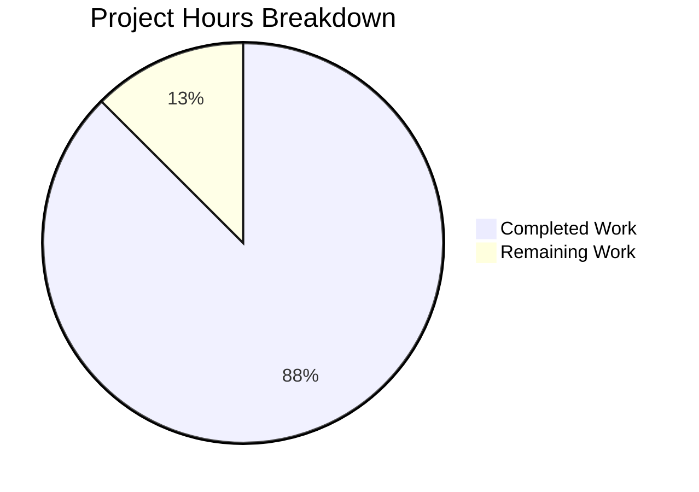

# 1. Executive Summary

## 1.1 Project Overview

A two-file Node.js console program that writes `WELCOME TO BLITZY` to standard output with no formatting: 17 characters plus the runtime's single newline. `index.js` at the repository root holds one JSDoc summary above one `console.log` statement, and `README.md` states on its third line how to run it. It has no framework, dependency, build step or configuration surface, holds no state and reads no input, and the deliverable is 5 lines and 160 bytes, verified on Node.js v22.23.3.

## 1.2 Completion Status

**14.0 of 16.0 hours complete — 87.5%.**



Completed = Dark Blue (#5B39F3); Remaining = White (#FFFFFF).

| Metric | Hours |
|---|---|
| Total Hours | 16.0 |
| Completed Hours (AI + Manual) | 14.0 |
| Remaining Hours | 2.0 |

## 1.3 Key Accomplishments

- [x] Delivered text in capitals: `node index.js` prints `WELCOME TO BLITZY` plus one newline — 18 bytes, exit 0, empty standard error.
- [x] Byte-exact source: two lines, 88 bytes, one statement, a tag-free summary quoting it.
- [x] Run instruction: `README.md:3`, the file still three lines with its earlier content byte-identical.
- [x] Deterministic: one output across sequential, concurrent and every input, directory, timezone and environment variation.
- [x] Fidelity: the same 18 bytes through pipes, files and a terminal, and under colour flags and every locale.
- [x] Zero dependencies: no manifest, lockfile or install step; only the runtime's built-in `console`.
- [x] Isolation: unchanged with filesystem access denied and cache paths pointed at the repository.
- [x] Safe: hostile payloads and injected credentials are never interpreted, echoed or leaked.

## 1.4 Critical Unresolved Issues

**4 of 24 scoped items remain open** — 19 project requirements plus 5 path-to-production items; 20 fully delivered, three outstanding and one caveat to accept.

| Issue | Impact | Owner | ETA |
|---|---|---|---|
| Human acceptance sign-off of the exact content and output, applied by hand because no automated gate may exist | Release cannot be signed off without it | Release owner | Before release — 1.0 h |
| Content and output confirmed on Node.js v22.23.3 only; no runtime is pinned anywhere | Behaviour unverified on other runtimes in use | Platform engineer | Before deployment — 0.5 h |
| The runtime prerequisite (a Node.js runtime on `PATH`, invoked from the repository root) and the expected output have no home in the delivered files | Readers who deviate from the documented command hit a runtime error | Release owner | With release notes — 0.5 h |
| Accepted caveat: no error path exists, so a closed or broken standard output still exits 0 with empty standard error | A consumer cannot detect truncation from the exit status | Consumer team | Accepted — no work owed |

## 1.5 Access Issues

No access issues identified. No credential, service, port or third-party API is needed, no environment variable is read, and the only prerequisite is a Node.js runtime on `PATH`.

## 1.6 Recommended Next Steps

1. [High] Sign off the content and output: run `node --check index.js` and compare `node index.js | od -An -c` against `W E L C O M E   T O   B L I T Z Y \n` (1.0 h).
2. [Medium] Run the same check on every Node.js version you deploy; only v22.23.3 is exercised (0.5 h).
3. [Low] Publish the runtime prerequisite and expected output outside the delivered files, whose content is fixed (0.5 h).
4. [Low] Record `d7e35021e22a03d90bd388fe18291349` as the expected fingerprint; keep `NODE_OPTIONS` to allowlisted flags.

# 2. Project Hours Breakdown

## 2.1 Completed Work Detail

| Component | Hours | Description |
|---|---|---|
| Console program `index.js` — output, structure, literal content | 2.0 | The two-line program that prints the fixed greeting, implemented against the fixed content and confirmed to parse cleanly: one JSDoc summary, one top-level semicolon-terminated statement, double-quoted literal, single end-of-file newline. |
| Run instruction in `README.md` | 1.0 | The single appended line stating how to run the program, added as an append that leaves the file's earlier content byte-identical and keeps it at three lines. |
| Delivered greeting in capitals, and comment coherence | 1.0 | The greeting and the comment that quotes it delivered in capital letters in place, with the comment, the literal and the emitted bytes confirmed to agree character for character and the new output fingerprint recorded. |
| Output-contract verification | 3.0 | Byte-exactness of the emitted output, stream, terminal, locale and environment fidelity, and determinism across sequential, concurrent and varied invocations. |
| Run-contract and invocation-surface verification | 2.0 | The documented command executed verbatim from the repository root, plus invocation by absolute path, relative path, symlink and from outside the repository, and the repository's acceptance one-liner. |
| Zero-dependency and no-hardening verification | 2.0 | Confirmation that no package, lockfile, module directory, install or build step exists or is needed, that no handler, environment configuration, logging, monitoring or telemetry was introduced, and that no input is read. |
| Content-integrity, comment and scope verification | 1.5 | Fewest-lines and token discipline, JSDoc shape with no tags, the documentation line ceiling, minimal diff with preserved existing content, and the two-file boundary with no side effect. |
| Hostile-input and secret-handling checks | 1.0 | Adversarial payloads in arguments, standard input and the environment, plus negative probes for credential, token and key leakage into either stream. |
| Acceptance and delivery-integrity confirmation | 0.5 | The exact-content and exact-output acceptance criterion confirmed on the environment's runtime, with working-tree content identical to the committed content. |
| **Total** | **14.0** | |

## 2.2 Remaining Work Detail

| Category | Hours | Priority |
|---|---|---|
| Human acceptance sign-off of the delivered content and exact output, applied by hand because the deliverable may not carry an automated gate | 1.0 | High |
| Confirm content and output on each Node.js version actually deployed — correctness is verified on v22.23.3 and no runtime is pinned | 0.5 | Medium |
| Publish the runtime prerequisite (runtime on `PATH`; invoke from the repository root; expected output) outside the delivered files, whose content is fixed | 0.5 | Low |
| **Total** | **2.0** | |

# 3. Test Results

Ninety-nine checks were executed against the delivered tree, which holds `index.js` (2 lines, 88 bytes) and `README.md` (3 lines, 72 bytes): 99 passed, 0 failed.

| Area / Category | Framework | Tests | Passed | Failed | Coverage | What This Proves |
|---|---|---|---|---|---|---|
| Source content contract (`index.js`) | Node.js parse gate plus byte comparison | 21 | 21 | 0 | Not measured — no coverage tooling exists or is permitted; acceptance is byte-exact content | The file ships exactly the two declared lines, one statement, a one-line tag-free summary that quotes what the program prints, and a single end-of-file newline |
| Runtime output contract | Node.js process checks | 14 | 14 | 0 | Not measured | The program writes exactly the 17-character capitalized greeting plus one newline — 18 bytes, one write, exit 0, nothing on standard error |
| Determinism and statelessness | Sequential and varied-invocation comparison | 9 | 9 | 0 | Not measured | Output cannot vary with arguments, standard input, working directory, timezone or environment |
| Documented run contract | Shell harness executing the published line | 9 | 9 | 0 | Not measured | The command the documentation states works as written, from other directories, through a symlink and on a copy outside the repository, and the tree holds no manifest, lockfile or test file |
| Terminal, locale and environment fidelity | Captured-byte comparison harness | 11 | 11 | 0 | Not measured | No emitted byte depends on terminal capability, colour flags, locale or environment, and the same 18 bytes arrive on a terminal |
| Invocation and argument tolerance | Shell harness | 17 | 17 | 0 | Not measured | Unknown flags, extreme argument counts and non-ASCII arguments leave the documented behaviour unchanged, and the deliberate refusals stay loud |
| Hostile input and secret handling | Adversarial payload harness | 8 | 8 | 0 | Not measured | No payload is interpreted or echoed, and injected credential values appear in neither stream |
| Concurrency, stream handling and isolation | Concurrent-run harness | 10 | 10 | 0 | Not measured | 64 concurrent runs agree byte for byte, every stream shape behaves identically, and no file, process or artefact is left behind |

**Not Covered.** Every capability this project delivers is exercised by the checks above. Two things no in-repository check can cover, because the deliverable may not carry a test suite, manifest or lockfile, are: (1) human acceptance of the exact output against the requirement — run `node --check index.js`, then compare `node index.js | od -An -c` against `W E L C O M E   T O   B L I T Z Y \n` through a pipe or a file, never through a captured terminal, which renders the newline as CRLF; and (2) behaviour on Node.js runtimes other than v22.23.3, the only one exercised. No coverage percentage is reported: no coverage tooling exists or is permitted, and acceptance rests on byte-exact content and output rather than a coverage target.

# 4. Runtime Validation & UI Verification

Every line below reports a surface that was actually driven on the delivered tree, with what was observed.

- ✅ **Startup and run** — `node index.js` from the repository root: exit status 0, 18 bytes on standard output, 0 bytes on standard error, process self-terminating inside a 30-second bound.
- ✅ **Output bytes** — exactly the 17-character capitalized greeting plus one newline: no escape sequence, colour code, emoji, banner, wrapper, `Output:` label or surrounding quotation mark, and a single line.
- ✅ **Determinism** — one distinct output and one distinct digest across five sequential runs, 64-way concurrency, and every argument, standard-input, working-directory, timezone and environment variation.
- ✅ **Documented command** — the line published in `README.md:3` extracted and executed verbatim from the repository root produced byte-identical output, and the acceptance one-liner printed its success marker.
- ✅ **Stream handling** — redirect to a file, to `/dev/null`, to `/dev/full`, through a pipe, with a closed descriptor and with an early-closing reader: exit status 0 in every shape, no diagnostic output (see the accepted caveat in Section 6).
- ✅ **Terminal, locale and environment fidelity** — pipe, file and terminal captures agree byte for byte, and output is identical under colour flags, an empty environment, hostile `HOME`/`TMPDIR`/`XDG` values and every locale configuration available on the host.
- ✅ **Argument and standard-input tolerance** — unknown flags, a 3 000-argument invocation, a 100 000-character argument, non-ASCII and newline-carrying arguments, and empty, closed and 1 MB standard input: documented behaviour unchanged.
- ✅ **Isolation and non-invasiveness** — unchanged under the runtime's permission model with filesystem, subprocess and worker access denied; no file created or modified in the repository, no listening port, no lingering process, no log or cache artefact.
- ✅ **Hostile input** — script, command-substitution, XSS and format-string payloads delivered as arguments and standard input are never interpreted or echoed, and injected credential, token and key values appear in neither stream.
- ➖ **Never exercised, because it does not exist** — there is no HTTP endpoint, API, database, queue, scheduler, authentication flow, third-party integration or deployment pipeline, and the program renders no user interface, so there is no screen to open and no browser or visual check that applies to this deliverable. Nothing of this kind was simulated or assumed.

# 5. Compliance & Quality Review

## 5.1 Compliance Matrix

| Deliverable / Benchmark | Verified State | Verified By |
|---|---|---|
| Exact, unformatted output in the delivered letters | ✅ Pass | `index.js:2`; 18-byte output verified through pipes, files and a terminal |
| Output fidelity across capture paths and environments | ✅ Pass | Pipe, file and terminal captures agree byte for byte; locales, colour flags, `TERM`, timezone and an emptied environment leave the bytes unchanged |
| Minimal implementation and token discipline | ✅ Pass | 2 lines / 88 bytes; one statement, one comment line, no wrapper, helper or second statement |
| Comment discipline and coherence: one-line JSDoc, no tags, quoting what the program prints | ✅ Pass | `index.js:1`; zero `@param`, `@returns` or `@example`; the quoted text equals the printed literal character for character |
| Documentation: run instruction, under five lines, no forbidden section | ✅ Pass | `README.md` is 3 lines; the documented command runs as written |
| Determinism and no external input | ✅ Pass | No argument, environment, file or clock dependency; one distinct output across every variation, sequential and 64-way concurrent |
| Accurate install and run story | ✅ Pass | Nothing installed or built; no manifest, lockfile or dependency directory exists |
| Zero dependencies | ✅ Pass | Zero `require`/`import` occurrences; the tracked tree holds no manifest or package artifact |
| No unrequested hardening | ✅ Pass | No handler, environment configuration, logging, monitoring or telemetry in either file |
| Minimal diff with existing content preserved | ✅ Pass | 2 lines replaced in place, differing only by letter case; the pre-existing documentation lines byte-identical |
| Performance expectations | ✅ Pass (no budget) | One synchronous write at process start, observed as a single 18-byte read; nothing measured and nothing claimed |
| Repository hygiene, scope boundary and security baseline | ✅ Pass | The delivered change touches `index.js` alone, the working tree is clean after every run, and neither file carries a credential, endpoint or input surface; hostile payloads are never interpreted |

## 5.2 AAP & Rule Divergences and Gaps

| What the AAP / Rule Required | What Was Delivered Instead | Why It Diverged | Impact | Remediation |
|---|---|---|---|---|
| Standard quality benchmark: a test suite or test files with a coverage gate, and a linter pass over each modified file | No test file, suite, lockfile, manifest or linter run anywhere in the tree; byte-exact content and output are the acceptance criterion | The request's own binding directives, the zero-dependency requirement and the scope boundary forbid adding a test suite, a lockfile, a dependency or any tooling — and no linter, formatter or runner exists in the repository to run | No automated regression guard: a future edit to the literal, the comment or the run line is caught only by re-reading | None owed — the manual acceptance step in Section 2.2 covers this; adding a suite or tooling would breach the delivered scope |
| The greeting value fixed throughout the plan (`Welcome to Blitzy` in FR-1, FR-2, FR-3, FR-5, §0.1.2, §0.5.1, §0.5.4, §0.8.1, §0.11.1, §0.11.2 and NFR-1's recorded bytes) | The greeting is delivered in capital letters in both places `index.js` carries it, and the program's output is 18 bytes with fingerprint `d7e35021e22a03d90bd388fe18291349` | The change was refined on request, after the plan was written: the text it delivers was to be presented in capital letters, in place. That instruction outranks the plan — **Sanctioned** | None on behaviour: every other property of those sections holds — no formatting, one statement, one tag-free comment line, a literal deterministic string, one trailing newline | None — the capitals are the directed content; the superseded values are never treated as defects or failed gates |
| The refinement instruction: no other file in the change is touched | Exactly that — `index.js` alone — so the expectations the acceptance rests on were not revised in the same change | The instruction forbids touching any other file, and the plan fixes the deliverable at the two root files — **Sanctioned** | The earlier acceptance one-liner and fingerprint no longer match the program and exit 1 when replayed verbatim | None owed for the change; the capitalized values are the ones recorded in this guide |
| AAP §0.8.1: a branded `# Welcome to Blitzy` heading, reserved for a repository with no `README.md` | The pre-existing slug `# bip-np-2-testing-4c516918` is retained as line 1 | The file already existed, so the conditional form does not apply; the instruction introduces no title and the minimal-diff rule keeps the earlier lines byte-identical | Nothing delivered names the greeting in prose; a reader learns the output by running the program | Human decision only, and it would change content the specification fixes (`README.md:1`) |
| AAP §0.8.1: the run line's text is fixed verbatim, and no install or further instruction line is permitted | The line states neither the working directory nor the expected output, and no runtime pointer accompanies it | The added line's exact text and the prohibition on further lines are both binding | A reader must already know that Node.js is on `PATH` and that the command runs from the repository root | Publish the prerequisite outside the delivered files (Section 2.2, `README.md:3`) |
| AAP §0.5.1: the file is exactly two lines, with no shebang | No shebang and no execute bit, so `./index.js` is refused | The content is fixed as exactly two lines and the documented invocation is `node index.js` | Direct execution prints `Permission denied` (status 126) instead of the greeting | None owed — the documented invocation works by absolute path, relative path and symlink; a shebang would breach the fixed content |
| NFR-3 and the no-hardening directive: no error handler, signal handler or other hardening | A closed, broken or unwritable standard output still exits 0 with empty standard error | Any handler would be hardening the request did not ask for and the plan forbids | A consumer reading the output through a pipeline cannot detect truncation from the exit status | None owed — accept the caveat recorded in Section 1.4 and treat a missing output line as failure |
| AAP §0.11.1: open only the files the change touches, with no repository-wide search | One bounded, read-only search for the earlier text, to establish which files had to be left untouched | The instruction required knowing which files carry the earlier text so they would be deliberately left alone — **Sanctioned** | None — the search was read-only and nothing it found was edited | None owed; the restriction that no other line changes stands and is verified |

**No test suite, test file, lockfile, manifest or linter pass.** A standard delivery would lint each modified file and ship tests behind a coverage gate. Neither happened, and neither may: the repository holds no linter, formatter, runner, manifest or lockfile, and the request's own binding directives and the zero-dependency requirement forbid adding one. The cost is that nothing fails loudly if the greeting, the comment or the run line is edited later; the countermeasure is the byte comparison and fingerprint in the development guide, applied before each release. Adding a suite or a linter would breach the scope the request fixed, so no work is owed.

**The delivered greeting is the requested refinement.** The text was asked for in capital letters, in place, and that instruction outranks the plan. What it altered is a value and nothing else: `index.js:2` prints `WELCOME TO BLITZY`, and the comment on line 1 quotes the same string, so the file does not contradict itself. Every property the plan fixed around that string still holds — one statement, one tag-free summary line, no formatting, label or surrounding quotation marks, a literal never composed from arguments, environment variables, files or the clock, and one trailing newline as the only byte beyond the seventeen characters. The expected output is 18 bytes with fingerprint `d7e35021e22a03d90bd388fe18291349`, and no remediation is owed.

**The change carried no other file with it.** The instruction required that, and only `index.js` differs — but the consequence is reader-visible and worth stating. The expectations acceptance rests on — the expected output line, the acceptance one-liner and the output fingerprint — were not revised alongside the greeting, so the earlier one-liner, replayed verbatim, exits 1 without printing its marker, and the earlier fingerprint digests a string the program no longer prints. The values that now govern are the capitalized ones: `WELCOME TO BLITZY\n`, 18 bytes, digest `d7e35021e22a03d90bd388fe18291349`. Nothing beyond that is owed.

**The documentation title keeps the existing repository slug.** The plan provides a branded two-line form for a repository with no `README.md`; this one has a file already carrying two lines, so that form does not apply, and both the instruction to introduce no title and the minimal-diff rule keep those lines byte-identical. The consequence is where a reader may expect different wording: nothing delivered names the string the program prints (`README.md:3`). Closing that is a human judgement rather than a repair, and it would change content the specification fixes. No edit is recommended.

**The run line is silent on the working directory and the output.** Its text is fixed verbatim, and no second instruction line, heading or install section may be added, so the file neither states that the command assumes the repository root nor says what the program prints, and it carries no pointer that a Node.js runtime must be on `PATH`. A reader who supplies a path to the file succeeds from any directory, as verified; one who types the bare relative command elsewhere gets Node's module-resolution error instead of guidance. The gap closes outside the delivered files — publish the prerequisite and the expected output in the release notes (Section 2.2, 0.5 h).

**The program is not directly executable.** Running `./index.js` without naming the runtime fails with `Permission denied` and exit status 126, because the file has no shebang and no execute bit. That is the fixed content rather than an oversight: two lines only, invoked as `node index.js`. Readers who follow the documentation are unaffected, and the entry point behaves identically by absolute path, relative path, through a symlink, and as a copy taken outside the repository. A shebang or an execute bit would depart from the fixed content, so no remediation is owed; the refusal is recorded so it is understood rather than mistaken for a defective entry point.

**A failed write is silent.** With standard output closed, pointed at an unwritable device, or connected to a reader that exits immediately, the program still exits 0 and writes nothing to standard error. The no-hardening requirement forbids an error or signal handler, so this is by design and was exercised deliberately in those shapes. The consequence falls on consumers: a downstream process cannot infer truncation from the exit status, so a consumer that must be certain of its input should treat a missing output line as failure. This is the accepted caveat in Section 1.4, carried as a risk in Section 6; no work is owed beyond that acknowledgement.

**Knowing which files to leave alone took one read-only search.** The plan's delivery guidance is to open only the files the change touches, with no repository-wide search. Establishing which files carried the earlier text — and therefore had to be left untouched — could not be done that way, so one bounded, read-only search was made for that purpose alone. Nothing it found was edited: the files it identified outside `index.js` are byte-identical to their earlier content, and the restriction that no other line changes stands and was verified. The departure has no effect on the delivered program, and no remediation is owed.

# 6. Risk Assessment

| Risk | Category | Severity | Probability | Mitigation | Status |
|---|---|---|---|---|---|
| No automated gate guards the delivered text: a later edit to the greeting, the comment or the run line would not fail any check | Technical | Medium | Medium | Apply the byte comparison and fingerprint in the development guide's verification step before each release | Open — accepted by design; the deliverable may not carry a test suite or manifest |
| The runtime is unpinned, so correctness has been established on Node.js v22.23.3 only | Technical | Low | Low | Run the same acceptance one-liner on each Node.js version actually deployed | Open — 0.5 h in Section 2.2 |
| A failed write is silent: a closed, broken or unwritable standard output still exits 0 and writes nothing to standard error | Operational | Low | Low | Consumers treat a missing output line as failure rather than inferring success from the exit status | Accepted caveat — no remediation owed |
| Consumer mis-invocation: direct execution of the file is refused (status 126), and the bare relative command fails outside the repository root | Operational | Low | Medium | Publish the runtime prerequisite and the expected output outside the delivered files | Open — 0.5 h in Section 2.2 |
| A host-level `NODE_OPTIONS` restriction can stop the runtime before any program code loads, leaving no output at all | Operational | Low | Low | Keep `NODE_OPTIONS` to allowlisted flags in any wrapper, and treat a missing output line as failure | Open — no separate work; addressed by the release-notes step |
| There is no packaging, publication or deployment path: nothing is built, bundled or served, so there is no artefact to ship | Operational | Low | Low | None required within scope; the documented run command is self-contained | Accepted by scope — no deployment target exists in this project |
| No integration surface exists: no HTTP endpoint, database, queue, scheduler or third-party service, and no outbound network call | Integration | None | None | Not applicable — the program runs unchanged with filesystem access denied and needs no service to reach | No risk carried |
| No security surface exists: no credential or secret in either file, no input accepted, no dependency to supply, no filesystem, subprocess or network access | Security | None | None | Not applicable — hostile payloads were exercised and are never interpreted, and injected secrets never reach either stream | No residual risk identified |

# 7. Visual Project Status

Project hours: 14.0 completed (Dark Blue #5B39F3) against 2.0 remaining (White #FFFFFF) — 87.5% complete.


Remaining hours by category, from Section 2.2:

| Category | Hours | Priority |
|---|---|---|
| Human acceptance sign-off of the delivered content and exact output | 1.0 | High |
| Confirm content and output on each Node.js version actually deployed | 0.5 | Medium |
| Publish the runtime prerequisite outside the delivered files | 0.5 | Low |
| **Total** | **2.0** | |

Delivered scope is complete on both paths: `index.js` (2 lines, 88 bytes) and `README.md` (3 lines, 72 bytes) hold exactly the specified content, with the greeting and the comment that quotes it replaced in place, 3 lines added and none removed.

# 8. Summary & Recommendations

The project delivers a two-line Node.js console program that prints `WELCOME TO BLITZY` to standard output with no formatting — in the capital letters the change was asked for — plus the one-line run instruction that tells a reader how to execute it. Both files sit at the repository root: `index.js` (2 lines, 88 bytes) holds a single JSDoc summary above a single `console.log` statement, and `README.md` (3 lines, 72 bytes) carries the run line as an append that left its earlier content byte-identical. The change adds 3 lines, replaces 2 in place and removes none, introduces no dependency, manifest, lockfile, build step or configuration surface, and touches nothing else in the tree. Against the work scoped for it, 14.0 of 16.0 hours are complete — 87.5%.

Verification is complete against that delivered state. Ninety-nine checks confirm the source holds exactly the specified content, that the program emits exactly seventeen characters plus one newline — 18 bytes, exit status 0, nothing on standard error — and that the bytes are identical through pipes, files and a terminal, across sequential and 64-way concurrent execution, under colour flags, empty and hostile environments and every available locale. The comment that documents the program quotes the string it prints, character for character. The program is unchanged under the runtime's permission model with filesystem, subprocess and worker access denied, leaves no file, port, process or log artefact behind, never interprets a hostile payload, and never echoes an injected secret value. Two behaviours are deliberate and settled rather than defective: a closed or broken standard output still exits 0 with empty standard error, and the file is not directly executable.

Three actions remain, totalling 2.0 hours, and they form the critical path to a signed-off release. First, the acceptance step itself: because the deliverable may not carry a test suite, a manifest or a lockfile, the exact content and the exact output must be confirmed by hand — 1.0 hour, the only item that gates sign-off. Second, the same check on every Node.js version actually deployed, since correctness has been demonstrated on v22.23.3 and no runtime is pinned — 0.5 hour. Third, publishing the runtime prerequisite and the expected output outside the delivered files, whose content is fixed — 0.5 hour. One further item is settled rather than outstanding: the caveat that a failed write is silent needs acknowledgement by consumers, not work.

Production readiness for what this project is — a demonstration program with no deployment target — is **ready**. Its success measures are met in full: the output is byte-exact and deterministic, the source is exactly as specified, there is no dependency or configuration to maintain, and the program is inert with respect to the host. The one structural property to live with is the absence of an automated gate, which the project's own constraints require: nothing in the repository will fail loudly if the greeting, the comment or the run line is edited later, so the comparison documented in the development guide is the guard — `node --check index.js` followed by `node index.js | od -An -c` against `W E L C O M E   T O   B L I T Z Y \n`, with `d7e35021e22a03d90bd388fe18291349` as the expected fingerprint.

Recommended course: sign off the content and output, run the check on the versions you deploy, and record the prerequisite in the release notes. No code change is recommended — every remaining item is an acceptance or communication step, and each change one might be tempted to make (a shebang, an error handler, a test suite, a manifest, a rewording of the run line) would breach a constraint the project was explicitly built to honour.

# 9. Development Guide

### System Prerequisites

- A Node.js runtime on `PATH`. Verified on Node.js v22.23.3 (`node --version` → `v22.23.3`); the program uses only a string literal and the runtime's built-in `console`, so any current release runs it unchanged.
- No package manager, compiler, container runtime, database or other tooling is required, and no operating-system-specific behaviour exists.
- No environment variable, secret or configuration file is read or needed.

### Repository Layout

```
├── index.js      # the program: one JSDoc summary, one console.log statement
├── README.md     # 3 lines, the last of which states how to run the program
└── blitzy/documentation/   # this record, as tracked in the repository
```

The two files that carry the deliverable sit at the repository root. There is no source directory, no manifest, no lockfile, no dependency directory, no test directory and no build output; the only other tracked file is this record itself, kept under `blitzy/documentation/`.

### Environment Setup and Dependencies

None. There is nothing to install, nothing to compile and nothing to configure: no virtual environment, no `npm install`, no build command, no service to start, no port to reserve and no database to create. Cloning the repository is the whole setup.

### Running the Program

From the repository root:

```bash
node index.js
```

Expected output, and nothing else:

```
WELCOME TO BLITZY
```

Exit status is `0` and nothing is written to standard error. The command is the one `README.md` documents, and it is the only supported invocation: run it from the repository root, or name the file explicitly from any other directory.

### Verifying a Checkout

```bash
# 1. Parse check — the equivalent of a compile step for a repository with no build system
node --check index.js                      # no output; exit status 0

# 2. Byte-exact output: 18 bytes, the string plus one newline
node index.js | wc -c                      # 18
node index.js | od -An -c                  # W E L C O M E   T O   B L I T Z Y \n

# 3. The acceptance gate: exact output, exact exit status, nothing on standard error
node --check index.js && test "$(node index.js)" = "WELCOME TO BLITZY" && echo GATE-OK   # GATE-OK

# 4. Stable fingerprint for spotting a silent change
node index.js | md5sum                     # d7e35021e22a03d90bd388fe18291349  -

# 5. Confirm nothing else in the tree moved
git status --porcelain                     # empty on a clean checkout
```

Compare output through a pipe or a file redirect, never through a captured terminal: a pseudo-terminal renders the trailing newline as CRLF (19 bytes instead of 18).

### Example Usage in a Script

```bash
# Capture the greeting and fail the script if the program misbehaves
if out="$(node index.js)"; then
  printf 'captured: %s\n' "$out"           # captured: WELCOME TO BLITZY
else
  printf 'program failed with status %s\n' "$?" >&2
fi

# Verify the digest inside a pipeline
node index.js | md5sum | grep -q '^d7e35021e22a03d90bd388fe18291349' && echo OUTPUT-UNCHANGED
```

The program reads no arguments, standard input or environment variables, so flags, piped input and environment settings are ignored and cannot change the output. Because a failed write is silent, a consumer that must be certain of the greeting should treat a missing output line as failure rather than trusting the exit status.

### Troubleshooting

| Symptom | Cause | Resolution |
|---|---|---|
| `Permission denied` with exit status 126 when running `./index.js` | The file carries no shebang and no execute bit by design | Invoke the runtime explicitly: `node index.js` |
| `MODULE_NOT_FOUND` with a loader stack trace | The bare relative command was run from a directory other than the repository root | Change to the repository root, or name the file explicitly: `node ./index.js` from the root, or the file's path from elsewhere |
| Output looks like 19 bytes or shows `\r\n` | The capture went through a pseudo-terminal, whose line discipline translates the newline | Capture through a pipe or a file: `node index.js > out.txt` |
| Output differs from `WELCOME TO BLITZY`, or extra text appears on standard error | The source was edited | Restore `index.js` to its two specified lines and re-run the verification step above |
| Command not found: `node` | No Node.js runtime on `PATH` | Install a current Node.js release, or invoke the runtime by its full path |
| No output at all, with the process failing before it starts | A disallowed flag is set in `NODE_OPTIONS`; the runtime refuses to launch before any program code loads | Remove the flag, or pass it on the command line where it is allowed: `node --no-warnings index.js` |

### Making Changes Safely

Both files are fixed by the project's specification, so treat any edit as a change to the requirement rather than a maintenance task. The greeting is the string literal on `index.js:2`, and the comment above it quotes the same string, so the two move together; the run line is `README.md:3`. After any edit, re-run the verification step and confirm the byte count, the `od` view and the fingerprint `d7e35021e22a03d90bd388fe18291349`; because the project carries no test suite or manifest by design, that comparison is the only guard.

# 10. Appendices

## A. Command Reference

| Command (from the repository root) | Purpose | Expected Result |
|---|---|---|
| `node --version` | Confirm the runtime is present and which release it is | `v22.23.3` |
| `node --check index.js` | Parse the program without executing it | No output; exit status 0 |
| `node index.js` | Run the program | `WELCOME TO BLITZY`; exit status 0; nothing on standard error |
| `node index.js \| wc -c` | Count the emitted bytes | `18` |
| `node index.js \| od -An -c` | Inspect the emitted bytes | `W E L C O M E   T O   B L I T Z Y \n` |
| `node index.js \| sed -n l` | Show the line with invisible characters made visible | `WELCOME TO BLITZY$` |
| `node index.js \| md5sum` | Fingerprint the output | `d7e35021e22a03d90bd388fe18291349` |
| `node --check index.js && test "$(node index.js)" = "WELCOME TO BLITZY" && echo GATE-OK` | The acceptance gate in one line | `GATE-OK` |
| `node --permission index.js` | Run under the runtime's permission model with filesystem, subprocess and worker access denied | `WELCOME TO BLITZY`; exit status 0 |
| `git ls-files` | List the tracked file set | `README.md`, `index.js` and this record under `blitzy/documentation/` |
| `git diff --numstat origin/main...HEAD` | Show the size of the change | `1 0 README.md`, `2 0 index.js`, and this record's `346 0` |

## B. Port Reference

None. The program opens no socket, binds no port and starts no listener; no port needs to be reserved or firewalled for it, and no long-running process remains after it exits.

## C. Key File Locations

| Path | Content | Notes |
|---|---|---|
| `index.js` | 2 lines, 88 bytes: one JSDoc summary and one `console.log` statement | The entire program; the printed string is the literal on line 2, delivered in capitals and quoted identically by the comment on line 1 |
| `README.md` | 3 lines, 72 bytes: the pre-existing title and credit lines plus the run instruction on line 3 | The only documentation; the run line's text is fixed |
| `blitzy/documentation/Project Guide - 8afb1828-c161-4751-8c48-bca9c0219f00.md` | This record, as tracked in the repository | The verification, risk and remaining-work record a reader works from |

## D. Technology Versions

| Component | Version | Notes |
|---|---|---|
| Node.js runtime | v22.23.3 (verified) | The only technology the program uses; the built-in `console` is invoked, and no version is pinned anywhere in the repository |
| Package manager | Not used | No manifest, lockfile or dependency directory exists, and no package command was run |
| Framework, database, bundler, transpiler | None | None is present or required |

## E. Environment Variable Reference

None. The program reads no environment variable, and none is required, configured or templated. Output was verified byte-identical with an empty environment, with colour and locale variables set, and with credential, token and key variables injected — in the last case, neither stream carried any of those values.

## F. Developer Tools Guide

Only the runtime and ordinary shell utilities are needed, and all of them are already present. Use `node --check` as the compile-equivalent check; `wc -c`, `od -An -c`, `sed -n l`, `cmp` and `md5sum` for byte-level comparison; `md5sum` for a stable fingerprint (`d7e35021e22a03d90bd388fe18291349` for the delivered greeting); and `git ls-files` / `git diff --numstat` to confirm the change stays inside the two delivered files. For concurrency checks, launch runs in the background, collect each capture in its own file, then compare digests. For a sandbox check, `node --permission index.js` denies filesystem, subprocess and worker access and the program still prints. No linter, formatter, test runner or coverage tool is installed, and none may be added to this repository. Never compare captured output through a terminal emulator — it inserts a carriage return before the newline; always compare through a pipe or a file.

## G. Glossary

| Term | Meaning here |
|---|---|
| Acceptance criterion | The condition that declares the change complete: both files hold exactly the specified content and `node index.js` prints `WELCOME TO BLITZY` |
| Byte-exact | Matching on every emitted byte, verified with byte-count and byte-dump comparisons rather than by eye |
| Determinism | Every run produces the same output, because the printed value is a literal and nothing is read from arguments, input, environment, files or the clock |
| EPIPE | The error raised in a writer when the process reading its output goes away; a feeder writing past the pipe buffer sees it while the program still exits 0 |
| Exit status | The number a process returns to its caller; 0 means success, and 126 here means the file was executed without the runtime and refused |
| JSDoc summary | The single `/** … */` comment line at the top of the program, carrying no parameter or return tags and quoting the string the program prints |
| Minimal diff | The smallest possible change: 3 lines added, none deleted, two of them replaced in place so the greeting reads in capitals |
| Permission model | The runtime's `--permission` mode, which can deny filesystem, subprocess and worker access; used to show the program touches none of them |
| Pseudo-terminal (pty) | A terminal emulation whose line discipline translates the trailing newline to CRLF, which is why byte comparisons use pipes or files |
| Zero dependencies | No package, development dependency, lockfile or manifest accompanies the change |
